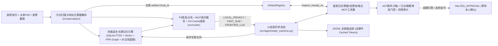

# Personal-Steward-Agent (TripLedger) 系统架构与算法设计规范

## 1. 垂直业务场景定位：个人差旅、票据核验与跨项目日程财务管家

通用个人助手常见的问题是“功能拼盘化、缺乏高频低容错闭环”。本系统锚定 **个人差旅管理与票据财务报销（Personal Travel, Receipt & Expense Steward）** 这一高频刚需场景，所有技术模块均严格对应真实业务痛点：

| 真实差旅报销痛点 | 传统方案缺陷 | 本系统融合架构解法 |
| :--- | :--- | :--- |
| **多页酒店水单 PDF / 交通截图多轮对账 Token 爆炸且易算错钱** | 每轮对话重复发送数千 Token 全页原图，大模型心算多笔税费易出现小数偏差，报销单差一分钱即被退回。 | **地址化票据构件注册表（`ArtifactRegistry`）+ 坐标级局部 ROI 放大（`inspect_receipt_roi`）+ 零特权 `ASTExpenseCalculator`**。 |
| **外部供应商电子发票暗藏间接提示词注入** | 发票备注或隐藏文本层写入恶意指令诱导越权操作，普通 ReAct 无信任分级直接执行。 | **感知层提示词注入污点扫描（`is_tainted_untrusted`）+ 沙箱污点传播阻断（`ExpenseSandboxGuard`）**。 |
| **航班改签/会议改期导致旧票误报，跨项目差标与审批人分散在历史对话** | 纯向量检索把改签前旧航班一并召回；“客户拜访 → 归属项目 → 差标上限与审批人”跨两跳记忆无法仅靠词面匹配串起。 | **SQLite WAL `FTS5` + 水位线单值槽位超替（`superseded_by`）+ 纯 NumPy 带悬挂节点重分配的幂迭代 Personalized PageRank（PPR）有向多跳图谱 + 无关单据拒识门控**。 |
| **行程单含身份证/银行卡号不敢上传公网，14+ 工具全量挂载浪费 Token 与缓存** | 敏感 PII 直发公网旗舰 API 存在合规风险；每轮动态拼接记忆破坏 System Prompt 前缀导致硬件 KV-Cache 失效。 | **PII 敏感隐私本地端云三级路由 + 零 LLM 的 MCP 成对工具裁剪（`14 -> 6`）+ 恒定前缀硬件 Prefix KV-Cache 保全协议 + 审计失败自动升级模型**。 |
| **超差标或大额报销款自动划转存在不可逆资金风险** | 缺乏硬性金额门控与落盘文件完整性校验。 | **11 态契约有限状态机 + 超限额报销 `HALTED_APPROVAL` 人机审批挂起 + `SHA-256` 报销凭证快照审计**。 |

---

## 2. 系统总体拓扑图

---

## 3. 核心算法形式化定义

### 3.1 四路混合长期记忆检索与水位线槽位超替（`src/memory/`）

设活跃记忆集合为 $\mathcal{M}_{\text{active}}$（已排除被新水位线覆盖的历史旧槽位记录 `superseded_by != None`），有向实体关系图为 $\mathcal{G} = (\mathcal{V}, \mathcal{E})$。对查询 $q$（时间 $t_q$）：

1. **稠密语义余弦分**：$S_{\text{vec}}(q, m_i) = \max(0, \mathbf{e}_q^\top \mathbf{e}_i)$。
2. **SQLite `FTS5` 饱和词法分**：对双字组 Bigram 与英文词元执行 BM25 检索并经 $S_{\text{lex}} = \frac{|b_i|}{|b_i| + 1.5}$ 归一化至 $[0, 1)$。
3. **带悬挂节点重分配的有向幂迭代 PPR 图谱分**：
   构造种子重启向量 $\mathbf{p}$，对出度为 $0$ 的悬挂节点指示向量 $\mathbf{z}$ 执行幂迭代：
   $$\boldsymbol{\pi}^{(k+1)} = (1 - \alpha)\mathbf{p} + \alpha\Big(\mathbf{P}^\top \boldsymbol{\pi}^{(k)} + (\mathbf{z}^\top \boldsymbol{\pi}^{(k)})\mathbf{p}\Big)$$
   将记忆 $m_i$ 关联实体的稳态概率求和并按当前候选最大值归一化为 $S_{\text{ppr}}(q, m_i) \in [0, 1]$。
4. **带复述巩固的艾宾浩斯时间衰减乘子**：
   $$D(t_q, m_i) = \exp\left(-\frac{\ln 2 \cdot \Delta h_i}{H_0 \cdot (1 + 0.5 \ln(1 + c_i))}\right) \cdot (0.75 + 0.25 s_i)$$
5. **联合得分与拒识门控（Abstention Gate）**：
   $$S_{\text{final}}(q, m_i) = \big(w_v S_{\text{vec}} + w_l S_{\text{lex}} + w_g S_{\text{ppr}}\big) \cdot D(t_q, m_i)$$
   当 $\max_i S_{\text{final}}(q, m_i) < \tau_{\text{abstain}}$ 时触发主动拒识返回空集，防止误引无关历史票据。

### 3.2 MCP 成对工具裁剪与 Prefix KV-Cache 保全（`src/router/`）

- **成对完整性约束**：工具按命名空间划分为 `(discover, act)` 配对组（如 `mcp_expense_pool_query` 与 `mcp_expense_export_voucher`）。裁剪器在预算 $B = 6$ 内若选中任一成员，自动补齐其配对工具，消除“查得出经费却缺导出工具”的多步断链。
- **字节级前缀恒定协议**：`messages[0]` 固定为不可变 `IMMUTABLE_SYSTEM_PROMPT`（SHA-256 锁定），所有动态召回记忆、票据句柄与审计反馈统一封装进用户轮 `<context_envelope>`，确保多轮连续报销核验直接命中云端推理引擎的硬件 Prefix KV-Cache。
