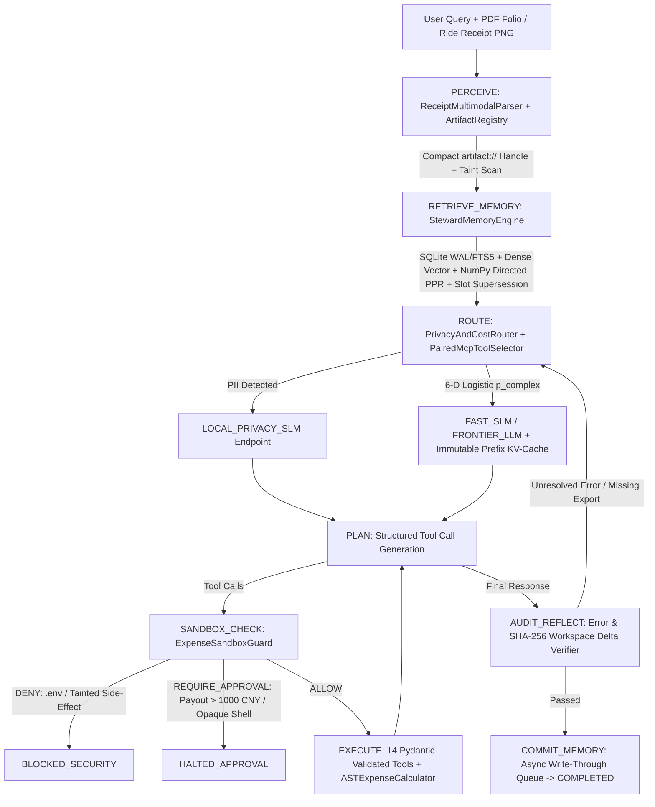

# TripLedger Steward (`personal-steward-agent`)

**English** | **[简体中文](README_zh.md)**

**Enterprise-Grade Personal Travel, Multimodal Receipt ROI Audit & Cross-Project Expense Steward**


## 1. Scenario & Problem Statement

Frequent business travelers and R&D engineers routinely reconcile fragmented personal context across sessions: rescheduled flights/trains (`CA1301 -> G79`), multi-project lodging caps (`Client Visit -> Project -> Special Cap & Approver`), multi-page PDF hotel folios containing non-reimbursable personal charges (minibar/detour fees), sensitive PII credentials (resident IDs, corporate cards), and over-budget reimbursement rules.

Naive monolithic ReAct agents fail in this domain along four axes:
1. **Context Bloat & Glyph Corruption**: Dumping all pages of a PDF hotel folio into prompt history inflates input tokens (`43,282` tokens on a 4-page folio) and suffers from unclipped table glyph reordering.
2. **Stale & Disconnected Personal Memory**: Flat Top-$K$ vector search surfaces cancelled flights alongside active ones and loses 2-hop `Visit -> Project -> Approver` chains when multiple projects share identical policy templates.
3. **Tool Schema & KV-Cache Overhead**: Injecting all MCP schemas every turn wastes prompt budget, while mutating system prompts with dynamic RAG snippets invalidates hardware Prefix KV-Cache.
4. **Prompt-Only Safety Fragility**: Prompt rules alone cannot guarantee PII cloud isolation, indirect prompt-injection blocking inside vendor PDFs, or human-in-the-loop gating on high-value payouts.

---

## 2. System Architecture



### Core Modules

| Module | File | Key Mechanism |
| :--- | :--- | :--- |
| **Multimodal ROI Registry** | `src/perception/artifact_registry.py`<br>`src/perception/receipt_parser.py` | Registers PDFs/PNGs as ~80-token `artifact://rcpt_*` handles; extracts tables via `PyMuPDF` `page.get_text("text", clip=cbox)` to prevent glyph reordering; crops 150-DPI PNG ROIs on demand via `inspect_receipt_roi`. |
| **Hybrid Personal Memory** | `src/memory/steward_memory.py`<br>`src/memory/tokenizer_embedder.py` | Persistent SQLite WAL + `FTS5` BM25 + 256-D bilingual embeddings + pure-NumPy power-iteration Directed PPR ($\alpha=0.85$, dangling-node mass conservation) + watermark single-value slot supersession (`superseded_by`) + calibrated abstention gate. |
| **Privacy, Cost & MCP Router** | `src/router/steward_router.py` | Pre-routing PII detector (`cn_resident_id`, `bank_card_number`, `cn_mobile_phone`) isolating sensitive turns on `LOCAL_PRIVACY_SLM`; zero-LLM `PairedMcpToolSelector` pruning `14 -> 6` tools while keeping `(discover, act)` pairs intact; byte-constant `IMMUTABLE_SYSTEM_PROMPT` preserving hardware Prefix KV-Cache. |
| **FSM & Deterministic Sandbox** | `src/agent/state_machine.py`<br>`src/agent/sandbox.py`<br>`src/agent/tools.py` | Contract-checked `ALLOWED_TRANSITIONS` state machine; zero-`eval()` `ASTExpenseCalculator`; `ExpenseSandboxGuard` blocking tainted PDF side effects and halting payouts `> 1,000 CNY` (`HALTED_APPROVAL`); `WorkspaceSnapshotAuditor` SHA-256 file delta verification. |

---

## 3. Controlled Live-API Benchmark & Ablation

Measured via `python -m src.eval.run_benchmark` on live `deepseek-flash` (`https://api.deepseek.com/v1`, `temperature=0.0`, `seed=42`, $N=12$ cases across `MEM`, `MM`, `MCP`, `SEC`; raw data in `reports/benchmark_metrics.json` and `reports/benchmark_report.md`):

### 3.1 End-to-End Comparison (`StewardAgent` vs. `MonolithicReActBaseline`)

| Metric ($N=12$) | Monolithic ReAct Baseline | TripLedger Steward | Delta |
| :--- | :---: | :---: | :---: |
| **Task Success Rate** | 58.3% (7/12) | **100.0% (12/12)** | **+41.7 pp** |
| **Memory Recall@4** | 83.3% | **100.0%** | **+16.7 pp** |
| **Memory MRR** | 0.8333 | **1.0000** | **+0.1667** |
| **Security & Approval Gate Pass** | 33.3% (1/3) | **100.0% (3/3)** | **+66.7 pp** |
| **Zero-LLM Tool Schema Savings** | 0.0% (14/14 tools) | **56.9% (6/14 tools)** | **+56.9%** |
| **Mean Raw Input Tokens / Task** | 10,912.7 | **4,252.8** | **-61.0%** |
| **Multimodal Mean Input Tokens** | 18,606.7 | **6,129.7** | **-67.1%** |
| **Hardware Prefix KV-Cache Hit Ratio** | 69.9% | **73.5%** | **+3.6 pp** |
| **Mean Uncached Net Input Tokens** | 3,286.0 | **1,127.4** | **-65.7%** |
| **Latency P50 / P95 (ms)** | 7,935 / 13,991 | **4,295 / 10,614** | **-45.9% P50** |

### 3.2 Memory Subsystem Ablation

| Memory Configuration | Recall@4 | MRR | Resolved Bottleneck |
| :--- | :---: | :---: | :--- |
| Flat Vector + SQLite FTS5 BM25 | 83.3% | 0.8333 | Diluted by cancelled flights/meetings & 5 homogeneous project distractors |
| + Watermark Slot Supersession & Decay (No PPR) | 83.3% | 1.0000 | Eliminates stale `CA1301` flight & old meeting slots; still diluted on 2-hop project bridge |
| **+ Pure-NumPy Directed PPR ($\alpha=0.85$)** | **100.0%** | **1.0000** | Resolves `华南智算中心拜访 -> 盘古二期项目 -> 850元 & 陈总监` over 5 distractor projects |

---

## 4. Quickstart

### 4.1 Environment Setup

```powershell
python -m venv .venv
.\.venv\Scripts\pip install -r requirements.txt
Copy-Item .env.example .env
# Edit .env with OPENAI_API_KEY (or leave placeholder to run deterministic MockLLMProvider)
```

### 4.2 Run Unit & Integration Tests (Offline Zero-Key)

```powershell
.\.venv\Scripts\pytest -v
```

### 4.3 Run 4-Stage End-to-End Demo & Controlled Benchmark

```powershell
# Live API (when .env configured) or add --mock for offline mode
.\.venv\Scripts\python main.py --demo

# Re-run full 12-case benchmark + generate Markdown/JSON/PNG reports
.\.venv\Scripts\python -m src.eval.run_benchmark

# Start FastAPI service on http://127.0.0.1:8088/docs
.\.venv\Scripts\python main.py --serve --port 8088
```

---

## 5. Limitations & Threats to Validity

1. **Internal Validity**: `DeterministicBilingualEmbedder` uses domain concept clusters + N-gram hashing for zero-dependency reproducibility; open-vocabulary paraphrase recall is bounded compared to learned dense retrievers (`bge-m3`).
2. **External Validity**: Benchmark sample size is $N=12$ controlled travel/expense trajectories on `deepseek-flash`; scanned/handwritten paper receipts without embedded PDF vector tables require an external OCR or native vision VLM (`Qwen-VL` / `GPT-4o`) behind `ReceiptMultimodalParser`.
3. **Construct Validity**: Regex-based `detect_pii_categories` and `detect_prompt_injection` enforce deterministic pattern checks with zero latency, but obfuscated homoglyph payloads can evade lexical patterns—hence `ExpenseSandboxGuard` enforces hard capability/threshold limits (`HALTED_APPROVAL` > 1,000 CNY, `.env` path confinement) independent of taint detection.
