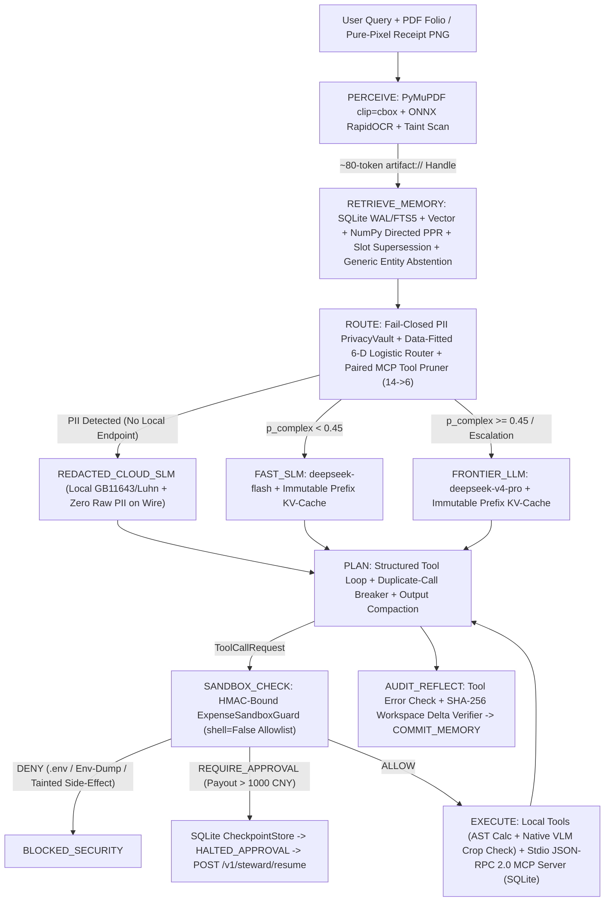

# TripLedger Steward (`personal-steward-agent` v2.0)

**English** | **[简体中文](README_zh.md)**

**Production-Hardened Personal Travel, Pure-Pixel Multimodal Receipt Audit & Cross-Project Expense Steward**


## 1. Architecture & Engineering Highlights (v2.0)

TripLedger Steward anchors Personal Agent research in a high-frequency, low-tolerance vertical: reconciling rescheduled trips (`CA1301 -> G79`), 2-hop cross-project lodging caps (`Client Visit -> Project -> Approver & Cost Center`), multi-page PDF hotel folios & pure-pixel receipt screenshots, sensitive PII verification, and human-approved reimbursement payouts.



### Core Subsystems (Zero Third-Party Agent Frameworks)

| Subsystem | Source Files | Verified Implementation |
| :--- | :--- | :--- |
| **Real `stdio` JSON-RPC 2.0 MCP** | `src/mcp/server.py`<br>`src/mcp/client.py` | Isolated child process speaking MCP `2024-11-05` (`initialize`, `tools/list`, `tools/call`) with sanitized child env (API keys stripped) and persistent SQLite WAL tables (`itinerary_events`, `budget_pools`, `travel_notes`, `payout_ledger` with `UNIQUE(idempotency_key)`). |
| **Pure-Pixel OCR + Native VLM ROI** | `src/perception/receipt_parser.py`<br>`src/perception/artifact_registry.py` | PDF tables extracted via `PyMuPDF` `page.get_text("text", clip=cbox)` with date-column filtering; raw PNG receipts parsed from pixels via ONNX `RapidOCR` (zero PNG metadata shortcuts) and visually cross-verified on cropped `base64_png` via native VLM (`deepseek-flash`). |
| **Hybrid Personal Memory Engine** | `src/memory/steward_memory.py`<br>`src/memory/tokenizer_embedder.py` | SQLite WAL + `FTS5` BM25 + 256-D bilingual embeddings + pure-NumPy power-iteration Directed PPR ($\alpha=0.85$, dangling-node mass conservation) + Watermark Slot Supersession + domain-agnostic Entity-Coverage Abstention Gate (zero hardcoded cities/brands). |
| **Fail-Closed PII Vault & Fitted Router** | `src/router/steward_router.py` | Locally computes GB 11643 ID & Luhn card checksums and strips raw PII (`<PII_CN_ID_1>`) before cloud calls when no `LOCAL_SLM_BASE_URL` is set; 6-D logistic weights fitted via NumPy gradient descent (`Held-Out Acc=95.8%`, `Brier=0.0247`, `ECE=0.1028`); paired MCP pruning (`14 -> 6`); byte-constant Prefix KV-Cache. |
| **FSM, Checkpoint Resume & Hardened Sandbox** | `src/agent/state_machine.py`<br>`src/agent/sandbox.py`<br>`src/agent/tools.py` | 13-state `ALLOWED_TRANSITIONS` FSM; SQLite `CheckpointStore` enabling true `HALTED_APPROVAL -> resume(checkpoint_id, approval_token)` with HMAC-SHA256 parameter binding; `ASTExpenseCalculator` (no `eval()`); `shell=False` allowlisted diagnostics; duplicate-call loop breaker & tool output compaction. |

---

## 2. Controlled Live Heterogeneous Benchmark & Ablations

Measured via `python -m src.eval.run_benchmark` (`temperature=0.0`, `seed=42`; raw logs in `reports/benchmark_metrics.json` & `reports/benchmark_report.md`) using true heterogeneous live models (`LLM=deepseek-v4-pro`, `SLM=deepseek-flash`, `VLM=deepseek-flash`) against a fair single-injection ReAct baseline (`deepseek-v4-pro`, identical 6-step budget, real `stdio` MCP & `RapidOCR`):

### 2.1 Live Heterogeneous End-to-End Comparison ($N=16$)

| Metric | Fair ReAct Baseline (`deepseek-v4-pro`) | TripLedger Steward v2 (Heterogeneous) | Delta |
| :--- | :---: | :---: | :---: |
| **Task Success Rate** ($N=16$) | 75.0% (12/16) | **93.8% (15/16)** | **+18.8 pp** |
| **Security, PII Vault & HITL Resume** ($N=4$) | 25.0% (1/4) | **100.0% (4/4)** | **+75.0 pp** |
| **Zero-LLM Paired Tool Schema Savings** | 0.0% (14/14 tools) | **54.9% (6/14 tools)** | **+54.9%** |
| **Heterogeneous SLM Offload Ratio** | 0.0% (100% Frontier) | **64.7%** | **+64.7%** |
| **Mean Raw Input Tokens / Task** | 6,386.2 | **3,966.0** | **-37.9%** |
| **Hardware Prefix KV-Cache Hit Ratio** | 62.8% | **83.1%** | **+20.3 pp** |
| **Mean Uncached Net Input Tokens** | 2,378.2 | **670.0** | **-71.8%** |
| **Latency P50 / P95 (ms)** | 7,426 / 34,041 | **4,423 / 16,321** | **-40.4% P50 / -52.1% P95** |

### 2.2 Memory 4-Stage Component Ablation ($N=24$: 6 Supersession + 6 Multi-Hop + 6 Abstention + 6 Hard Paraphrase)

| Memory Configuration | Recall@4 (95% CI) | MRR | Supersession Acc | Multi-Hop Recall | Hard Paraphrase | Abstention F1 |
| :--- | :---: | :---: | :---: | :---: | :---: | :---: |
| Flat Vector + SQLite FTS5 BM25 | 94.4% ± 6.9% | 0.8796 | 66.7% | 91.7% | 91.7% | 0.0% |
| + Watermark Slot Supersession | 88.9% ± 8.3% | 0.9722 | **100.0%** | 75.0% | 91.7% | 0.0% |
| + Pure-NumPy Directed PPR ($\alpha=0.85$) | **97.2% ± 4.2%** | **0.9722** | **100.0%** | **100.0%** | 91.7% | 0.0% |
| **+ Generic Entity-Coverage Abstention (Full)** | **97.2% ± 4.2%** | **0.9722** | **100.0%** | **100.0%** | **91.7%** | **90.9%** |

### 2.3 Documented Bad Cases & Failure Mode Boundaries

1. **Memory `M23` (Zero-Overlap Colloquial Paraphrase)**: `"月底华东那场边缘计算大会的经费归属和主管是谁？"` recalled bridge `mem_pg_bridge` (`华东边缘峰会 -> 盘古二期项目`) but missed 2-hop `mem_pg_rule` because `"边缘计算大会"` lacked exact seed overlap with graph node `"华东边缘峰会"`. Fix path: replace N-gram hash embedder with learned multilingual dense encoder (`bge-m3`) + semantic entity linking.
2. **E2E `MEM-04` (Tool-Induced Cross-Domain Leakage After Memory Abstention)**: Even though `StewardMemoryEngine` accurately abstained on the unrecorded Harbin hotel query (`abstained=True`), `deepseek-flash` proactively invoked `mcp_expense_pool_query` and quoted `PRJ-PANGU-2`'s `850` CNY cap as an unrequested side note. Fix path: restrict financial pool lookups when `<recalled_memories status="abstained_or_empty" />` on historical-expense lookup intents.

---

## 3. Quickstart

```powershell
python -m venv .venv
.\.venv\Scripts\pip install -r requirements.txt
Copy-Item .env.example .env

# 1. Offline zero-key unit & integration tests (stdio MCP, RapidOCR, PrivacyVault, Checkpoint Resume)
.\.venv\Scripts\pytest -v

# 2. Live heterogeneous demo (or add --mock for offline mode)
.\.venv\Scripts\python main.py --demo

# 3. Full N_mem=24 + N_router=24 + N_e2e=16 benchmark & 200-DPI ablation chart
.\.venv\Scripts\python -m src.eval.run_benchmark

# 4. Start FastAPI server (POST /v1/steward/run and POST /v1/steward/resume)
.\.venv\Scripts\python main.py --serve --port 8088
```
