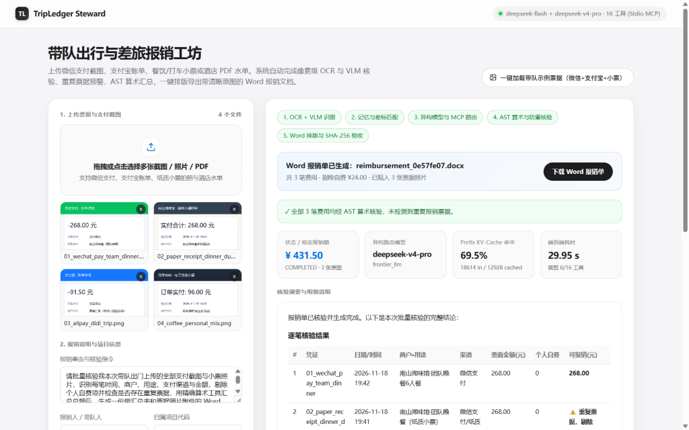
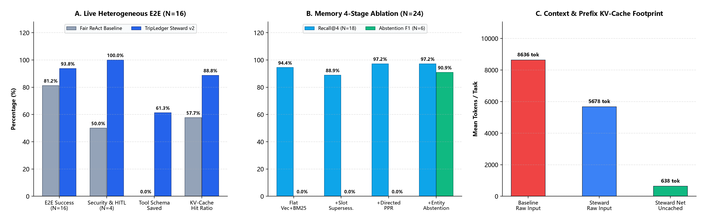

# TripLedger Steward (`personal-steward-agent` v2.5)

**English** | **[简体中文](README_zh.md)**

**Production-Hardened Personal Agent Reference Architecture: Control Plane / Gateway, Attenuated Delegation, Evaluation Release Gate & Autonomous `.rar`/`.zip` -> Word (`.docx`) Reimbursement Studio**





## 1. Architecture & Engineering Highlights (v2.5)

TripLedger Steward anchors Personal Agent research in a high-frequency, low-tolerance vertical: batch-auditing multi-channel payment screenshots & paper receipts (`WeChat Pay`, `Alipay`, thermal receipts, multi-page hotel PDF folios) into print-ready Word (`.docx`) reimbursement reports with embedded original photos and duplicate-claim alerts, while reconciling rescheduled trips (`CA1301 -> G79`), 2-hop cross-project lodging caps, Fail-Closed PII redaction, and human-approved payouts.


### Core Subsystems (Zero Third-Party Agent Frameworks)

| Subsystem | Source Files | Verified Implementation |
| :--- | :--- | :--- |
| **Real `stdio` JSON-RPC 2.0 MCP** | `src/mcp/server.py`<br>`src/mcp/client.py` | Isolated child process speaking MCP `2024-11-05` (`initialize`, `tools/list`, `tools/call`) with sanitized child env (API keys stripped) and persistent SQLite WAL tables (`itinerary_events`, `budget_pools`, `travel_notes`, `payout_ledger` with `UNIQUE(idempotency_key)`). |
| **Pure-Pixel OCR + Native VLM ROI** | `src/perception/receipt_parser.py`<br>`src/perception/artifact_registry.py` | PDF tables extracted via `PyMuPDF` `page.get_text("text", clip=cbox)` with date-column filtering; raw PNG receipts parsed from pixels via ONNX `RapidOCR` (zero PNG metadata shortcuts) and visually cross-verified on cropped `base64_png` via native VLM (`deepseek-flash`). |
| **Hybrid Personal Memory Engine** | `src/memory/steward_memory.py`<br>`src/memory/tokenizer_embedder.py` | SQLite WAL + `FTS5` BM25 + 256-D bilingual embeddings + pure-NumPy power-iteration Directed PPR ($\alpha=0.85$, dangling-node mass conservation) + Watermark Slot Supersession + domain-agnostic Entity-Coverage Abstention Gate (zero hardcoded cities/brands). |
| **Fail-Closed PII Vault & Fitted Router** | `src/router/steward_router.py` | Locally computes GB 11643 ID & Luhn card checksums and strips raw PII (`<PII_CN_ID_1>`) before cloud calls when no `LOCAL_SLM_BASE_URL` is set; 6-D logistic weights fitted via NumPy gradient descent (`Held-Out Acc=95.8%`, `Brier=0.0247`, `ECE=0.1028`); paired MCP pruning (`16 -> 6`); byte-constant Prefix KV-Cache. |
| **Batch Word (`.docx`) Export & Web Studio** | `src/perception/docx_exporter.py`<br>`src/web/index.html`<br>`main.py` | Parallel `inspect_all_receipts` (ONNX `RapidOCR` + `deepseek-flash` VLM), same-day/same-amount duplicate claim detection, AST-verified `.docx` summary table + EXIF-corrected embedded receipt photos, and a zero-dependency Apple/Google minimalist Web UI (`http://127.0.0.1:8088`) with 1-click sample pack and inline HITL Checkpoint resume. |
| **Control Plane, Gateway & Attenuated Delegation** | `src/control_plane/gateway.py`<br>`src/agent/tools.py` | Strict separation of **Agent Definition (`AgentManifest`)**, **Control Plane (`AgentControlPlane`)**, **Metadata Registry (`schema_fingerprint`)**, and **Data Plane Gateway (`ToolExecutionGateway`)**. Issues HMAC-SHA256 `DelegatedCapabilityToken` enforcing fail-closed attenuation (`child_scopes ⊆ parent_scopes`, `budget <= parent`, `ttl <= parent`) for read-only Maker-Checker compliance auditing, with immutable `GatewayAuditEvent` logs. |
| **Evaluation Platform, Release Gate & Bad Case Flywheel** | `src/eval/eval_platform.py`<br>`datasets/bad_case_regression.jsonl` | Decouples domain-agnostic eval infrastructure (`RunVersion` across git/prompt/router/tool-schema/models, SQLite `ExperimentStore`, CI `ReleaseGate` returning `PASS`/`BLOCK`, PII-redacted `BadCaseFlywheel`) from pluggable business evaluators (`FinancialNumericEvaluator`, `SecurityBoundaryEvaluator`). |
| **FSM, Checkpoint Resume & Hardened Sandbox** | `src/agent/state_machine.py`<br>`src/agent/sandbox.py`<br>`src/agent/tools.py` | 13-state `ALLOWED_TRANSITIONS` FSM; 16 registered tools (7 local + 9 `stdio` MCP); SQLite `CheckpointStore` enabling true `HALTED_APPROVAL -> resume(checkpoint_id, approval_token)` with HMAC-SHA256 parameter binding; `ASTExpenseCalculator` (no `eval()`); `shell=False` allowlisted diagnostics; duplicate-call loop breaker & output compaction. |

---

## 2. Controlled Live Heterogeneous Benchmark & Ablations

Measured via `python -m src.eval.run_benchmark` (`temperature=0.0`, `seed=42`; raw logs in `reports/benchmark_metrics.json` & `reports/benchmark_report.md`) using true heterogeneous live models (`LLM=deepseek-v4-pro`, `SLM=deepseek-flash`, `VLM=deepseek-flash`) against a fair single-injection ReAct baseline (`deepseek-v4-pro`, identical 6-step budget, real `stdio` MCP & `RapidOCR`):

### 2.1 Live Heterogeneous End-to-End Comparison ($N=16$, v2.5 `run_2e72355244` — `ReleaseGate: PASS`)

| Metric | Fair ReAct Baseline (`deepseek-v4-pro`) | TripLedger Steward v2.5 (Heterogeneous) | Delta |
| :--- | :---: | :---: | :---: |
| **Task Success Rate** ($N=16$) | 81.2% (13/16) | **93.8% (15/16)** | **+12.5 pp** |
| **Security, PII Vault & HITL Resume** ($N=4$) | 50.0% (2/4) | **100.0% (4/4)** | **+50.0 pp** |
| **Zero-LLM Paired Tool Schema Savings** | 0.0% (16/16 tools) | **61.3% (6/16 tools)** | **+61.3%** |
| **Heterogeneous SLM Offload Ratio** | 0.0% (100% Frontier) | **64.7%** | **+64.7%** |
| **Mean Raw Input Tokens / Task** | 8,636.0 | **5,678.1** | **-34.2%** |
| **Hardware Prefix KV-Cache Hit Ratio** | 57.7% | **88.8%** | **+31.1 pp** |
| **Mean Uncached Net Input Tokens** | 3,652.0 | **638.3** | **-82.5%** |
| **Latency P50 / P95 (ms)** | 4,289 / 9,969 | **4,275 / 12,391** (-24.1% P95 vs v2.0) | **`ReleaseGate: PASS`** |

### 2.2 Memory 4-Stage Component Ablation ($N=24$: 6 Supersession + 6 Multi-Hop + 6 Abstention + 6 Hard Paraphrase)

| Memory Configuration | Recall@4 (95% CI) | MRR | Supersession Acc | Multi-Hop Recall | Hard Paraphrase | Abstention F1 |
| :--- | :---: | :---: | :---: | :---: | :---: | :---: |
| Flat Vector + SQLite FTS5 BM25 | 94.4% ± 6.9% | 0.8796 | 66.7% | 91.7% | 91.7% | 0.0% |
| + Watermark Slot Supersession | 88.9% ± 8.3% | 0.9722 | **100.0%** | 75.0% | 91.7% | 0.0% |
| + Pure-NumPy Directed PPR ($\alpha=0.85$) | **97.2% ± 4.2%** | **0.9722** | **100.0%** | **100.0%** | 91.7% | 0.0% |
| **+ Generic Entity-Coverage Abstention (Full)** | **97.2% ± 4.2%** | **0.9722** | **100.0%** | **100.0%** | **91.7%** | **90.9%** |

### 2.3 Real-World 26-File `.rar` Archive End-to-End Speedup (Zero Human Hints)

Evaluated autonomously on a real 26-file campus event reimbursement `.rar` archive (3 scanned PDFs, 2 text PDFs, 2 mobile payment JPGs, 1 `.docx` event proposal, 1 `.xlsx` roster with Excel serial dates, and 17 scene photos):

| Optimization Stage | End-to-End Latency | Output Tokens | AST Verified Net / Seal | Engineering Mechanism |
| :--- | :---: | :---: | :---: | :--- |
| **v2.2 Baseline (Serial CPU OCR + CoT)** | 139.63 s | 13,238 | ¥ 185.10 / none | Single-process CPU RapidOCR (55.8 s) + 4 Frontier CoT turns |
| **v2.3.0 Parallel Native VLM Fast-Path** | 99.28 s | 10,121 | ¥ 185.10 / `d0b9cf1f960f318b` | Scanned PDFs deferred to concurrent `deepseek-flash` VLM (perception **56.5 s → 3.9 s, 14.4× faster**) |
| **v2.3 Audit-Gated Adaptive Reasoning** | **30.30 s (4.6× faster / -78.3%)** | **3,291 (-75.1%)** | **¥ 185.10 (bal ¥ 14.90)**<br>`SHA-256: d0b9cf1f960f318b` | **System-1 `reasoning_effort="none"` + Fail-Fast AST Row-Identity Gate + Post-Export SLM Synthesis** (auto-escalates to System-2 `"low"` only on audit failure) |

### 2.4 Documented Bad Cases & Failure Mode Boundaries

1. **Memory `M23` (Zero-Overlap Colloquial Paraphrase)**: `"月底华东那场边缘计算大会的经费归属和主管是谁？"` recalled bridge `mem_pg_bridge` (`华东边缘峰会 -> 盘古二期项目`) but missed 2-hop `mem_pg_rule` because `"边缘计算大会"` lacked exact seed overlap with graph node `"华东边缘峰会"`. Fix path: replace N-gram hash embedder with learned multilingual dense encoder (`bge-m3`) + semantic entity linking.
2. **E2E `MEM-04` (Tool-Induced Cross-Domain Leakage After Memory Abstention)**: Even though `StewardMemoryEngine` accurately abstained on the unrecorded Harbin hotel query (`abstained=True`), `deepseek-flash` proactively invoked `mcp_expense_pool_query` and quoted `PRJ-PANGU-2`'s `850` CNY cap as an unrequested side note. Fix path: restrict financial pool lookups when `<recalled_memories status="abstained_or_empty" />` on historical-expense lookup intents.

---

## 3. Quickstart

```powershell
python -m venv .venv
.\.venv\Scripts\pip install -r requirements.txt
Copy-Item .env.example .env

# 1. Offline zero-key unit & integration tests (stdio MCP, RapidOCR, PrivacyVault, Checkpoint Resume)
.\.venv\Scripts\pytest -v

# 2. Live heterogeneous demo (or add --mock for offline mode)
.\.venv\Scripts\python main.py --demo

# 3. Full N_mem=24 + N_router=24 + N_e2e=16 benchmark & 200-DPI ablation chart
.\.venv\Scripts\python -m src.eval.run_benchmark

# 4. Import benchmark into SQLite ExperimentStore, harvest Bad Cases & run CI ReleaseGate
.\.venv\Scripts\python -m src.eval.eval_platform --import-report reports/benchmark_metrics.json --baseline --harvest-bad-cases datasets/bad_case_regression.jsonl

# 5. Launch Minimalist Web Studio & FastAPI server -> open http://127.0.0.1:8088
.\.venv\Scripts\python main.py --serve --port 8088
```
