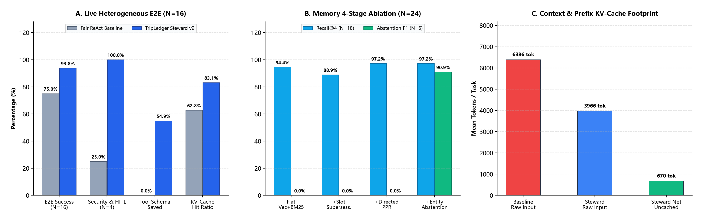
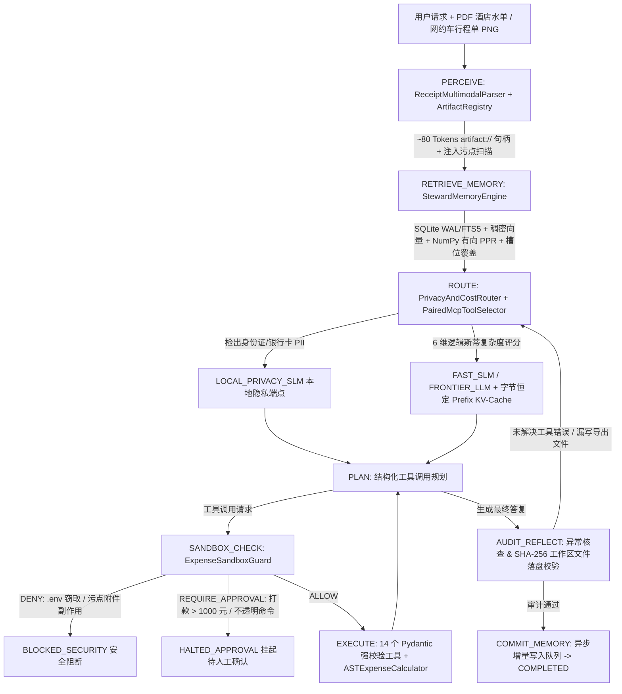

# TripLedger Steward (`personal-steward-agent`)

**[English](README.md)** | **简体中文**

**企业级个人差旅管理、多模态水单 ROI 局部核验与跨项目报销智能体系统**



## 1. 业务场景与核心问题界定

在高频商务差旅、驻场交付与跨项目研发报销场景中，个人智能体（Personal Agent）需要在跨会话周期内协同处理碎片化上下文：机票退改高铁记录（`CA1301 -> G79`）、多跳项目差标映射（`客户拜访 -> 归属项目 -> 特批住宿上限与审批人`）、包含不可报销个人消费（迷你吧 Minibar、个人绕路费）的多页 PDF 酒店水单与行程截图、敏感实名隐私信息（身份证号、公务银行卡号），以及大额资金打款审批边界。

传统单体式 ReAct 智能体在该场景中存在四类工程失效模式：
1. **上下文膨胀与表格字符重排**：将多页酒店水单全文直接拼入提示词会导致输入 Token 激增（4 页水单实测达 `43,282` Tokens），且未裁剪表格提取易发生数字与小数点乱序，受附录价目表噪声干扰算错金额。
2. **过期记忆污染与多跳关联断链**：扁平 Top-$K$ 向量检索会将已退票航班与改签后车次同时召回；当库内存在多个措辞同质化的项目差标规则时，缺乏图结构传播将丢失 `拜访事项 -> 归属项目 -> 终审审批人` 的 2 跳桥接链路。
3. **工具 Schema 冗余与 KV-Cache 失效**：每轮全量注入 14 个 MCP 工具 Schema 挤占输入预算；同时在 `system` 提示词中动态拼接时间戳或检索片段会破坏云端推理引擎的硬件级 Prefix KV-Cache。
4. **纯提示词安全约束脆弱**：仅靠自然语言规则无法物理保证实名 PII 不出域、无法根除供应商 PDF 水单内的间接提示词注入（Indirect Prompt Injection），也无法强约束超额报销打款的人工确认边界。

---

## 2. 系统架构拓扑



### 核心工程模块说明

| 模块层级 | 源码路径 | 核心机制与算法设计 |
| :--- | :--- | :--- |
| **多模态票据句柄与 ROI 裁剪** | `src/perception/artifact_registry.py`<br>`src/perception/receipt_parser.py` | 基于 SHA-256 幂等注册，将多页 PDF 与高清截图压缩为 ~80 Tokens 的 `artifact://rcpt_*` 句柄；采用 `PyMuPDF` 单元格坐标裁剪（`page.get_text("text", clip=cbox)`）消除字符重排并过滤日期列误提取；通过 `inspect_receipt_roi` 按需裁剪 150 DPI 局部区域。 |
| **混合个人长期记忆引擎** | `src/memory/steward_memory.py`<br>`src/memory/tokenizer_embedder.py` | 基于 SQLite WAL + `FTS5` 双字切词 BM25 + 256 维双语概念哈希向量 + 纯 NumPy 幂迭代有向个性化 PageRank（$\alpha=0.85$，含悬挂节点概率质量重分配）+ 水位线单值槽位覆盖（`superseded_by`）+ 校准拒答门控（Abstention Gate）。 |
| **隐私、成本与成对工具路由器** | `src/router/steward_router.py` | 路由前执行 PII 正则探针（身份证号、银行卡号、手机号），命中后强制锁定至 `LOCAL_PRIVACY_SLM`；零 LLM 开销的 `PairedMcpToolSelector` 将 14 个工具裁剪至 6 个并完整保留 `(query, act)` 依赖对；保持 `IMMUTABLE_SYSTEM_PROMPT` 字节级恒定以激活硬件 Prefix KV-Cache。 |
| **契约状态机与确定性安全沙箱** | `src/agent/state_machine.py`<br>`src/agent/sandbox.py`<br>`src/agent/tools.py` | 强校验 `ALLOWED_TRANSITIONS` 状态转移契约；零 `eval()` 权限的受限 AST 财务计算器 `ASTExpenseCalculator`；`ExpenseSandboxGuard` 阻断污点票据副作用并对 `> 1,000 CNY` 直接打款强制转入 `HALTED_APPROVAL`；`WorkspaceSnapshotAuditor` 执行前后 SHA-256 快照比对确保报销单真实落盘。 |

---

## 3. 受控在线 API 基准评测与消融实验

通过 `python -m src.eval.run_benchmark` 在真实在线 `deepseek-flash` 接口（`https://api.deepseek.com/v1`，固定 `temperature=0.0`，`seed=42`，测试样本量 $N=12$，覆盖 `MEM`、`MM`、`MCP`、`SEC` 四类场景）上实测，原始数据见 `reports/benchmark_metrics.json` 与 `reports/benchmark_report.md`：

### 3.1 端到端双架构对照（`StewardAgent` vs. `MonolithicReActBaseline`）

| 评测指标（$N=12$） | 单体 ReAct 基线 | TripLedger Steward（本项目） | 差量（Delta） |
| :--- | :---: | :---: | :---: |
| **任务成功率（Task Success Rate）** | 58.3% (7/12) | **100.0% (12/12)** | **+41.7 pp** |
| **记忆召回率（Memory Recall@4）** | 83.3% | **100.0%** | **+16.7 pp** |
| **记忆平均倒数排名（Memory MRR）** | 0.8333 | **1.0000** | **+0.1667** |
| **安全与审批门禁通过率** | 33.3% (1/3) | **100.0% (3/3)** | **+66.7 pp** |
| **零 LLM 工具 Schema Token 节省率** | 0.0% (14/14 工具) | **56.9% (6/14 工具)** | **+56.9%** |
| **单任务平均原始输入 Tokens** | 10,912.7 | **4,252.8** | **-61.0%** |
| **多模态水单用例平均输入 Tokens** | 18,606.7 | **6,129.7** | **-67.1%** |
| **硬件级 Prefix KV-Cache 命中率** | 69.9% | **73.5%** | **+3.6 pp** |
| **单任务平均未缓存净输入 Tokens** | 3,286.0 | **1,127.4** | **-65.7%** |
| **端到端延迟 P50 / P95（ms）** | 7,935 / 13,991 | **4,295 / 10,614** | **P50 降低 45.9%** |

### 3.2 记忆子系统组件消融（Component Ablation）

| 记忆引擎配置 | Recall@4 | MRR | 解决的核心瓶颈 |
| :--- | :---: | :---: | :--- |
| Flat Vector + SQLite FTS5 BM25 | 83.3% | 0.8333 | 受退票旧航班/旧会议污染，且被 5 个同质化项目规则干扰稀释 |
| + 水位线槽位覆盖与时间衰减（无 PPR） | 83.3% | 1.0000 | 消除旧航班 `CA1301` 与旧会议排期干扰，但 2 跳项目桥接仍受干扰项稀释 |
| **+ 纯 NumPy 有向 PPR（$\alpha=0.85$）** | **100.0%** | **1.0000** | 在 5 个同质项目干扰下准确召回 `华南智算中心拜访 -> 盘古二期项目 -> 850元 & 陈总监` |

---

## 4. 快速启动与复现指南

### 4.1 环境隔离与依赖安装

```powershell
python -m venv .venv
.\.venv\Scripts\pip install -r requirements.txt
Copy-Item .env.example .env
# 在 .env 中填入兼容 OpenAI 协议的 OPENAI_API_KEY（若保留占位符则自动启用离线确定性 MockLLMProvider）
```

### 4.2 运行离线单元测试与集成测试（零 API 密钥开销）

```powershell
.\.venv\Scripts\pytest -v
```

### 4.3 运行四阶段端到端演示、基准评测与 API 服务

```powershell
# 运行四阶段端到端演示（配置 .env 后默认调用在线 API，加 --mock 强制离线运行）
.\.venv\Scripts\python main.py --demo

# 重跑 12 用例双架构对照评测并生成 Markdown/JSON/PNG 报告
.\.venv\Scripts\python -m src.eval.run_benchmark

# 启动 FastAPI 接口服务（文档地址：http://127.0.0.1:8088/docs）
.\.venv\Scripts\python main.py --serve --port 8088
```

---

## 5. 系统局限性与有效性边界（Limitations & Threats to Validity）

1. **内部有效性边界**：`DeterministicBilingualEmbedder` 采用领域概念簇与字符/词级 N-gram 哈希保证单机零模型下载的可复现性，其开放域同义改写泛化能力受限于词面与概念表覆盖度，大规模生产部署可无缝替换为 `bge-m3` 等稠密编码器。
2. **外部有效性边界**：当前基准样本量为 $N=12$ 条受控差旅与报销轨迹（基于 `deepseek-flash` 实测）；对于无内嵌矢量文本层的纯拍照纸质发票或手写单据，需在 `ReceiptMultimodalParser` 后端挂载外部 OCR 引擎或原生视觉大模型（如 `Qwen-VL` / `GPT-4o`）。
3. **结构有效性边界**：基于正则表达式的 `detect_pii_categories` 与 `detect_prompt_injection` 具备零延迟确定性优势，但面对同形异义字符混淆或编码拆分载荷存在漏检可能；因此系统在最底层通过 `ExpenseSandboxGuard` 施加与文本检测解耦的硬权限门禁（`> 1,000 CNY` 强制人工审批、`.env` 敏感路径与工作区目录沙箱隔离）。
