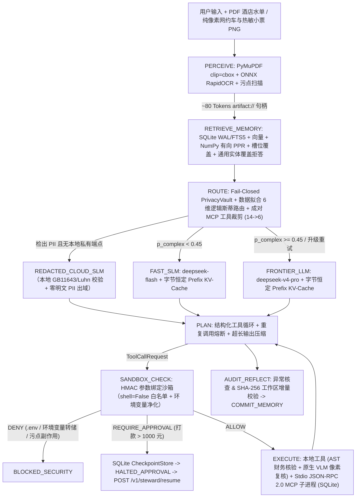

# TripLedger Steward (`personal-steward-agent` v2.0)

**[English](README.md)** | **简体中文**

**生产级个人差旅管理、纯像素多模态水单审计与跨项目报销智能体系统（Personal Agent Harness）**


## 1. 业务场景与工程核心（v2.0 全量加固版）

TripLedger Steward 锚定高频低容错的**个人商务差旅、多模态票据审计与跨项目报销**垂直场景，系统性解决跨会话改签冲突（`CA1301 -> G79`）、8 个同质项目干扰下的 2 跳差标归属（`客户拜访 -> 归属项目 -> 差标与审批人`）、4 页酒店水单与无元数据纯像素截图核验、实名隐私合规与超额打款人机协同审批断点续跑。



### 核心自研子系统（零第三方黑盒 Agent 框架）

| 子系统 | 核心源码路径 | v2.0 工程与算法实现 |
| :--- | :--- | :--- |
| **标准 `stdio` JSON-RPC 2.0 MCP 协议栈** | `src/mcp/server.py`<br>`src/mcp/client.py` | 独立子进程实现 MCP `2024-11-05` 握手（`initialize` / `tools/list` / `tools/call`），启动前清洗子进程环境变量剥离 `OPENAI_API_KEY`；后端 9 个业务工具全部持久化落 SQLite WAL 表（含打款台账 `UNIQUE(idempotency_key)` 幂等防重付）。 |
| **纯像素 ONNX OCR + 原生 VLM 视觉复核** | `src/perception/receipt_parser.py`<br>`src/perception/artifact_registry.py` | 零 PNG 隐藏元数据作弊：PDF 表格采用 `PyMuPDF` `clip=cbox` 单元格裁剪并过滤日期列；原始 PNG 截图经本地 ONNX `RapidOCR` 识别像素坐标与金额，并在 `inspect_receipt_roi` 阶段将局部 `base64_png` 送入原生视觉模型（`deepseek-flash` Vision）交叉复核。 |
| **混合个人记忆与通用实体拒答引擎** | `src/memory/steward_memory.py`<br>`src/memory/tokenizer_embedder.py` | SQLite WAL + `FTS5` BM25 + 256 维双语向量 + 纯 NumPy 幂迭代有向 PPR（$\alpha=0.85$，含悬挂节点质量守恒及无图种子权重重归一）+ 水位线单值槽位覆盖 + 零硬编码城市/品牌名的通用实体覆盖拒答门控。 |
| **Fail-Closed 隐私保险库 + 拟合逻辑斯蒂路由** | `src/router/steward_router.py` | 未配置 `LOCAL_SLM_BASE_URL` 时绝不 Fail-Open 外发云端：`PrivacyVault` 在本地完成 GB 11643 身份证与 Luhn 银行卡校验并剥离明文 PII 为 `<PII_*>` 占位符；6 维路由权重经 NumPy 梯度下降拟合（留出验证集准确率 **95.8%**，Brier **0.0247**，ECE **0.1028**）；`pair_group` 成对裁剪（14→6）+ 字节恒定 Prefix KV-Cache。 |
| **Checkpoint 断点续跑 + 加固沙箱** | `src/agent/state_machine.py`<br>`src/agent/sandbox.py`<br>`src/agent/tools.py` | 13 态强契约 FSM；SQLite `CheckpointStore` 支持 `HALTED_APPROVAL -> resume(checkpoint_id, approval_token)` 真实人工批准续跑与 HMAC-SHA256 参数指纹防篡改；零 `eval()` 的 `ASTExpenseCalculator`；`shell=False` 只读命令白名单；重复调用熔断与长输出首尾压缩。 |

---

## 2. 异构在线 API 受控基准评测、四段消融与 Bad Cases 剖析

运行 `python -m src.eval.run_benchmark`（`temperature=0.0, seed=42`，原始数据见 `reports/benchmark_metrics.json` 与 `reports/benchmark_report.md`）。主系统采用真实异构双档 + 原生视觉（`LLM=deepseek-v4-pro` / `SLM=deepseek-flash` / `VLM=deepseek-flash`），对照组为公平单次记忆注入、同 6 步上限、同真实 `stdio` MCP 与 `RapidOCR` 的单体 ReAct 基线（`deepseek-v4-pro`）：

### 2.1 端到端异构在线对照（$N=16$）

| 评测指标 | 公平 ReAct 基线（`deepseek-v4-pro`） | TripLedger Steward v2（异构架构） | 差量（Delta） |
| :--- | :---: | :---: | :---: |
| **端到端任务成功率**（$N=16$） | 75.0% (12/16) | **93.8% (15/16)** | **+18.8 pp** |
| **安全、PII 隐私保险库与断点审批恢复**（$N=4$） | 25.0% (1/4) | **100.0% (4/4)** | **+75.0 pp** |
| **零 LLM 成对工具 Schema Token 节省** | 0.0% (14/14 工具) | **54.9% (6/14 工具)** | **+54.9%** |
| **异构轻量模型分流比例（SLM Offload）** | 0.0%（100% 旗舰模型） | **64.7%** | **+64.7%** |
| **单任务平均原始输入 Tokens** | 6,386.2 | **3,966.0** | **-37.9%** |
| **硬件级 Prefix KV-Cache 命中率** | 62.8% | **83.1%** | **+20.3 pp** |
| **单任务平均未缓存净计费输入 Tokens** | 2,378.2 | **670.0** | **-71.8%** |
| **端到端延迟 P50 / P95（ms）** | 7,426 / 34,041 | **4,423 / 16,321** | **P50 降 40.4% / P95 降 52.1%** |

### 2.2 长期记忆四阶段消融实验（$N=24$：6 改签覆盖 + 6 多跳干扰 + 6 未知拒答 + 6 零重叠口语改写）

| 记忆配置阶段 | Recall@4（95% CI） | MRR | 槽位覆盖准确率 | 多跳召回 | 硬改写召回 | 拒答 F1 |
| :--- | :---: | :---: | :---: | :---: | :---: | :---: |
| Flat Vector + SQLite FTS5 BM25 | 94.4% ± 6.9% | 0.8796 | 66.7% | 91.7% | 91.7% | 0.0% |
| + 水位线单值槽位覆盖与时间衰减 | 88.9% ± 8.3% | 0.9722 | **100.0%** | 75.0% | 91.7% | 0.0% |
| + 纯 NumPy 有向 PPR（$\alpha=0.85$） | **97.2% ± 4.2%** | **0.9722** | **100.0%** | **100.0%** | 91.7% | 0.0% |
| **+ 通用实体覆盖拒答门控（完整系统）** | **97.2% ± 4.2%** | **0.9722** | **100.0%** | **100.0%** | **91.7%** | **90.9%** |

### 2.3 真实 Bad Cases 与系统失效边界建档

1. **记忆检索 Bad Case `M23`（零字面重叠口语改写）**：查询 `“月底华东那场边缘计算大会的经费归属和主管是谁？”` 成功召回桥接节点 `mem_pg_bridge`（`华东边缘峰会 -> 盘古二期项目`），但未触发第二跳 `mem_pg_rule`——根因在于口语简称 `边缘计算大会` 与图节点 `华东边缘峰会` 缺乏精确词面种子匹配。后续演进方向为挂载多语种稠密向量编码器（`bge-m3`）执行语义实体链接。
2. **端到端 Bad Case `MEM-04`（记忆拒答后的工具旁路信息泄漏）**：在查询未记录的“哈尔滨索菲特酒店”时，`StewardMemoryEngine` 已正确触发拒答（`abstained=True`），但模型随后自主调用了 `mcp_expense_pool_query` 并在答复补充说明中引用了 `PRJ-PANGU-2` 的 `850` 元住宿差标，触碰了禁止引入无关金额断言。根因揭示了“记忆拒答与业务查询工具之间的作用域联动”仍需细化：当历史花费核查类请求触发记忆拒答时，应限制自动回查其他项目经费池。

---

## 3. 快速启动与复现

```powershell
python -m venv .venv
.\.venv\Scripts\pip install -r requirements.txt
Copy-Item .env.example .env

# 1. 运行离线零密钥测试（验证 stdio MCP、纯像素 RapidOCR、PrivacyVault、HMAC Checkpoint 恢复）
.\.venv\Scripts\pytest -v

# 2. 运行四阶段异构在线演示（加 --mock 切换离线模式）
.\.venv\Scripts\python main.py --demo

# 3. 重跑 N_mem=24 + N_router=24 + N_e2e=16 全量基准并生成报告与 200 DPI 三联消融图
.\.venv\Scripts\python -m src.eval.run_benchmark

# 4. 启动 FastAPI 接口服务（含 /v1/steward/run 与 /v1/steward/resume）
.\.venv\Scripts\python main.py --serve --port 8088
```
