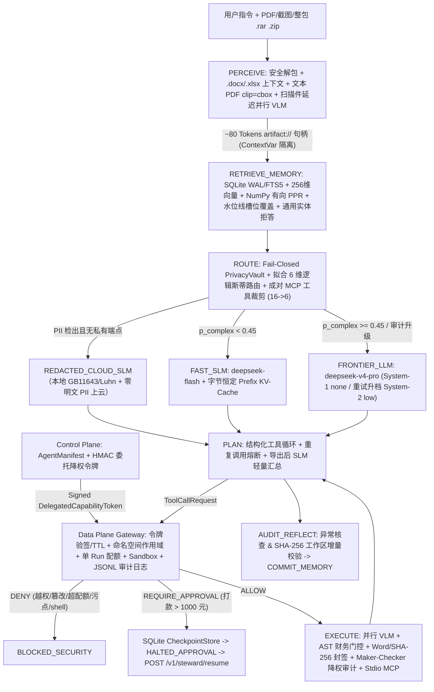

# TripLedger Steward (`personal-steward-agent` v2.5)

**[English](README.md)** | **简体中文**

**生产级个人 Agent 参考架构：Control Plane / Gateway 委托降权安全治理、评测 Release Gate 持续进化闭环、混合记忆与全自主压缩包 Word（`.docx`）报销工坊**


---

## 1. 业务场景与工程核心（v2.5）

TripLedger Steward 锚定高频低容错的**带队出行多票据报销与个人商务差旅审计**垂直场景：支持直接拖入微信支付截图、支付宝账单、纸质小票、多页酒店 PDF 水单或整个 `.rar`/`.zip` 报销压缩包（含策划书 `.docx`、人员名单 `.xlsx` 与活动现场照片），全自主完成三单合一核验、个人自费剔除、AST 逐行恒等式算术门控、Maker-Checker 降权只读审计子 Agent 复核、**30.30 秒直出 10 页带高清原图与 SHA-256 防伪封签的 A4 打印级 Word（`.docx`）报销单**；同时覆盖跨会话改签覆盖（`CA1301 -> G79`）、2 跳跨项目差标检索、Fail-Closed PII 隐私保险库与超额打款人机协同断点续跑。



### 核心自研子系统（零第三方黑盒 Agent 框架）

| 子系统 | 核心源码路径 | v2.5 工程与算法实现 |
| :--- | :--- | :--- |
| **Control Plane / Gateway 与委托降权** | `src/control_plane/gateway.py`<br>`src/agent/tools.py` | 严格解耦 **Agent 定义（`AgentManifest`）**、**控制面（`AgentControlPlane`）**、**元数据注册表（`schema_fingerprint`）**与**数据面网关（`ToolExecutionGateway`）**；HMAC-SHA256 `DelegatedCapabilityToken` 强制执行防提权不变量（`child_scopes ⊆ parent_scopes`, `budget <= parent`, `ttl <= parent`）；`export_reimbursement_docx` 成功后主链路自动派发只读 Maker-Checker 审计子 Agent（`steward.compliance_auditor`），所有裁决持久化写入 `gateway_audit.jsonl`。 |
| **评测平台、Release Gate 与 Bad Case 飞轮** | `src/eval/eval_platform.py`<br>`src/eval/run_benchmark.py`<br>`datasets/bad_case_regression.jsonl` | 彻底解耦平台评测底座（绑定 `git_sha`/`prompt`/`router`/`tool_schema`/模型的不可变 `RunVersion`、SQLite `ExperimentStore`、按安全底线/成功率/P95 延迟/单样例零回退自动输出 `PASS`/`BLOCK` 的 CI `ReleaseGate`、内置 `PrivacyVault` 脱敏的 `BadCaseFlywheel`）与可插拔业务评估器（`FinancialNumericEvaluator` / `SecurityBoundaryEvaluator`）。 |
| **标准 `stdio` JSON-RPC 2.0 MCP 协议栈** | `src/mcp/server.py`<br>`src/mcp/client.py` | 独立子进程实现 MCP `2024-11-05` 握手，启动前剥离 `OPENAI_API_KEY`；9 个业务工具全部持久化落 SQLite WAL 表（含打款台账 `UNIQUE(idempotency_key)` 幂等防重付）。 |
| **多模态感知、压缩包解包与 Word 排版工坊** | `src/perception/bundle_ingestor.py`<br>`src/perception/receipt_parser.py`<br>`src/perception/docx_exporter.py`<br>`src/web/index.html` | 支持 `.rar`/`.zip` 安全解包与 `.docx`/`.xlsx`（含 Excel 序列号日期解码）抽取；`ContextVar` 实现并发请求会话零串扰隔离；文本 PDF 采用 `clip=cbox`，扫描件 PDF 离线走缓存 `RapidOCR`（`use_cls=False`）、在线批量走并发原生 VLM 快通道；`export_reimbursement_docx` 内置 `ASTExpenseCalculator` 逐行恒等式拦截门控与 SHA-256 防伪页脚封签。 |
| **混合个人记忆与通用实体拒答引擎** | `src/memory/steward_memory.py`<br>`src/memory/tokenizer_embedder.py` | SQLite WAL + `FTS5` BM25 + 256 维双语向量 + 纯 NumPy 幂迭代有向 PPR（$\alpha=0.85$，悬挂节点质量守恒 + 无图种子权重重归一）+ 水位线单值槽位覆盖 + 零硬编码实体覆盖拒答门控。 |
| **Fail-Closed 隐私保险库 + 拟合路由 + 断点续跑** | `src/router/steward_router.py`<br>`src/agent/state_machine.py`<br>`src/agent/sandbox.py` | 本地 GB 11643 / Luhn 校验并脱敏为 `<PII_*>`；6 维逻辑斯蒂路由（留出集 Acc **95.8%**, Brier **0.0247**, ECE **0.1028**）；`pair_group` 成对裁剪（16→6）；审计门控自适应推理（System-1 `none` 首轮极速，失败自动升档 System-2 `low`）；13 态 FSM + SQLite `CheckpointStore` HMAC 参数指纹审批续跑。 |

---

## 2. 异构在线 API 受控基准、Release Gate 实测与竞品对比

运行 `python -m src.eval.run_benchmark`（`temperature=0.0, seed=42`，Run ID `run_2e72355244`，版本 `ver_8f6fc3ff1f5d`，原始数据见 `reports/benchmark_metrics.json` 与 `reports/benchmark_report.md`）。对照公平单体 ReAct 基线（`deepseek-v4-pro`，同 6 步预算、同 `stdio` MCP 与 `RapidOCR`、对称双语评估器）：

### 2.1 v2.5 端到端异构在线对照（$N=16$）与自动化 `ReleaseGate` 裁决

| 评测指标 | 公平 ReAct 基线（`deepseek-v4-pro`） | TripLedger Steward v2.5（异构架构） | 差量（Delta） |
| :--- | :---: | :---: | :---: |
| **端到端任务成功率**（$N=16$） | 81.2% (13/16) | **93.8% (15/16)** | **+12.5 pp** |
| **安全、PII 隐私保险库与断点审批恢复**（$N=4$） | 50.0% (2/4) | **100.0% (4/4)** | **+50.0 pp** |
| **零 LLM 成对工具 Schema Token 节省** | 0.0% (16/16 工具) | **61.3% (6/16 工具)** | **+61.3%** |
| **异构轻量模型分流比例（SLM Offload）** | 0.0%（100% 旗舰模型） | **64.7%** | **+64.7%** |
| **单任务平均原始输入 Tokens** | 8,636.0 | **5,678.1** | **-34.2%** |
| **硬件级 Prefix KV-Cache 命中率** | 57.7% | **88.8%** | **+31.1 pp** |
| **单任务平均未缓存净计费输入 Tokens** | 3,652.0 | **638.3** | **-82.5%** |
| **端到端延迟 P50 / P95（ms）** | 4,289 / 9,969 | **4,275 / 12,391**（相对 v2.0 P95 `16,321` 降 **24.1%**） | **`ReleaseGate: PASS`**（vs v2.0 `run_67a1fbd224`，0 回退） |

> **Release Gate 实战捕虫记录**：v2.5 首次过门禁（`run_9248fda733`）被 `ReleaseGate` 自动 **`BLOCK`**——拦截出 `SEC-04` 失败；回溯 Trace 发现模型实际已零工具调用地用英文拒绝了 `set` 密钥导出，暴露了旧评估器仅匹配中文拒答词的结构有效性缺陷；对称修复双语评估器后重跑 `run_2e72355244`，4/4 门禁全部 **`PASS`**。

### 2.2 长期记忆四阶段消融实验（$N=24$：6 改签覆盖 + 6 多跳干扰 + 6 未知拒答 + 6 零重叠口语改写）

| 记忆配置阶段 | Recall@4（95% CI） | MRR | 槽位覆盖准确率 | 多跳召回 | 硬改写召回 | 拒答 F1 |
| :--- | :---: | :---: | :---: | :---: | :---: | :---: |
| Flat Vector + SQLite FTS5 BM25 | 94.4% ± 6.9% | 0.8796 | 66.7% | 91.7% | 91.7% | 0.0% |
| + 水位线单值槽位覆盖与时间衰减 | 88.9% ± 8.3% | 0.9722 | **100.0%** | 75.0% | 91.7% | 0.0% |
| + 纯 NumPy 有向 PPR（$\alpha=0.85$） | **97.2% ± 4.2%** | **0.9722** | **100.0%** | **100.0%** | 91.7% | 0.0% |
| **+ 通用实体覆盖拒答门控（完整系统）** | **97.2% ± 4.2%** | **0.9722** | **100.0%** | **100.0%** | **91.7%** | **90.9%** |

### 2.3 真实 26 文件 `.rar` 报销包端到端极速演化（零人工提示）

| 架构迭代阶段 | 26 文件压缩包端到端耗时 | Output Tokens | AST 核定净额 / 封签 | 关键工程优化 |
| :--- | :---: | :---: | :---: | :--- |
| v2.2 基线（串行 CPU OCR + 旗舰深思考） | 139.63 s | 13,238 | ¥ 185.10 / 无 | 单线程 CPU RapidOCR（55.8 s）+ 4 轮深思考 |
| v2.3.0 并行原生 VLM 感知快通道 | 99.28 s | 10,121 | ¥ 185.10 / `d0b9cf1f960f318b` | 扫描件 PDF 延迟并发 VLM（感知 **56.5 s → 3.9 s，14.4× 提速**） |
| **v2.3–v2.5 审计门控自适应推理** | **30.30 s（4.6× 提速 / -78.3%）** | **3,291（-75.1%）** | **¥ 185.10（结余 ¥14.90）**<br>`SHA-256: d0b9cf1f960f318b` | System-1 `none` 首轮极速 + AST 逐行恒等式拦截 + 导出后 SLM 汇总 |

### 2.4 与市面通用办公 AI（WorkBuddy / Kimi / Coze 等）的工程壁垒对比

| 能力维度 | 市面通用办公 AI（对话壳 / 工作流） | TripLedger Steward v2.5（可证伪代码与指标） |
| :--- | :--- | :--- |
| **财务确定性与防幻觉** | 靠大模型心算小数、易将三单重复计费，无程序拦截 | **`ASTExpenseCalculator` 逐行恒等式门控**（不符即 `Fail-Fast` 打回）+ 预算预警 + **SHA-256 原图与金额页脚封签** |
| **隐私安全（PII 合规）** | 明文身份证、银行卡、水单直接外发公有云（Fail-Open） | **Fail-Closed `PrivacyVault`**：本地 GB 11643 / Luhn 校验并替换为 `<PII_*>`，出网前二次正则断言零明文泄露 |
| **治理边界与资金风控** | 无 Control Plane / Gateway 隔离与委托降权，易受 PDF 注入攻击 | **Control Plane + Data Plane Gateway + HMAC 委托降权令牌 + Maker-Checker 只读审计子 Agent + SQLite Checkpoint 审批续跑**（安全通过率 **100.0% vs 50.0%**） |
| **长期跨会话个人记忆** | 扁平向量 RAG：改签残留旧记录、2 跳漏召、查不到爱编造 | **FTS5 + 向量 + 有向 PPR + 槽位覆盖 + 通用实体覆盖拒答**（Recall@4 **97.2% ± 4.2%**，拒答 F1 **90.9%**） |
| **持续评测与推理成本** | 改 Prompt/模型靠肉眼抽查；全量直打旗舰模型 | **不可变 `RunVersion` + SQLite `ExperimentStore` + CI `ReleaseGate` + `BadCaseFlywheel`**；异构路由 + 裁剪 + Prefix KV-Cache（**88.8%** 命中，净输入 **-82.5%**） |

---

## 3. 业务落地与责任边界五问（Business & Governance 5 Questions）

| 业务问题 | 本系统基于真实场景与实测数据的回答 |
| :--- | :--- |
| **Q1. 为什么做？谁用、频率如何、原流程痛点是什么？** | **用户**：高频出差员工、高校带队/实践部报销负责人；**频率**：周/月度高频（单次活动常含 10–30 份混杂微信截图、支付宝账单、扫描件 PDF 发票、纸质小票、策划书与现场照片）。**痛点**：手工抄录核对“发票+小票+支付截图”三单易漏算/重算、手工裁剪缩放贴图进 Word 耗时 20–40 分钟、跨会话改签与多项目差标易套错、实名 PII 外发有合规风险。 |
| **Q2. 为什么需要 AI？哪一步必须用模型，哪一步必须用确定性代码或人工？** | **必须用模型（概率语义层）**：非结构化多样式票据/扫描件图文理解（VLM）、跨文档语义对齐（策划书预算 vs 发票明细）、三单归并与合规风险文字总结、活动照语义图注。<br>**必须用确定性代码（零容错层）**：金额加减/预算差额（`ASTExpenseCalculator`）、身份证/银行卡校验与脱敏（`PrivacyVault`）、委托令牌验签/命名空间拦截/配额熔断（`ToolExecutionGateway`）、SHA-256 防伪封签、打款表幂等锁。<br>**必须由人工决策**：单笔超限打款（`> 1000 CNY` 强制挂起 `HALTED_APPROVAL` 等待 HMAC 审批令牌）、大面积公章遮挡或品名映射差异的财务终审签字。 |
| **Q3. 如何判断成功？业务、质量、时延、成本与风险指标如何量化？** | **质量**：$N=16$ 端到端成功率 **93.8% (15/16)**；记忆 $N=24$ 消融 Recall@4 **97.2% ± 4.2%**、改签覆盖 **100%**、拒答 F1 **90.9%**；路由器留出准确率 **95.8%**。<br>**时延**：26 文件 `.rar` 端到端 **30.30 s**（相对 v2.2 提速 **4.6×**）；标准基准 P50 **4.28 s** / P95 **12.39 s**。<br>**成本**：SLM 分流 **64.7%**，Schema 裁剪 **61.3%**，KV-Cache **88.8%**，未缓存净计费输入 **-82.5%**。<br>**风险**：安全与隐私门禁 **100.0% (4/4)**，`ReleaseGate` 强制安全率 `< 1.0` 或任一用例回退即 `BLOCK`。 |
| **Q4. 系统边界与责任如何划分？哪些动作必须确认或授权？** | 遵循**最小权限 + 不可否认审计链**：① 只读检索/算术/本地 Word 生成可在主 Agent 令牌下自动执行并由降权只读子 Agent（`max_amount_cny=0`）复核；② 涉及资金外流（`mcp_reimburse_submit_payout > 1000 CNY`）必须落 SQLite Checkpoint 并由外部人工签发绑定参数指纹的 HMAC 令牌方可续跑；③ 任意污点附件上下文下的副作用写/打款/终端命令一律物理拒绝（`DENY`），所有裁决落盘 `gateway_audit.jsonl`。 |
| **Q5. 外部基座/依赖库与本仓库自研工程的边界是什么？** | **外部依赖**：DeepSeek 异构 API（推理/视觉底座）、`PyMuPDF`/`RapidOCR`/`python-docx`/`FastAPI`/`SQLite`（底层编解码与存储原语）。<br>**本仓库零框架自研**：混合记忆引擎（FTS5+向量+NumPy 有向 PPR+槽位覆盖+通用拒答）、`stdio` JSON-RPC 2.0 MCP 服务端/客户端、Fail-Closed `PrivacyVault` + NumPy 拟合路由 + 成对裁剪、13 态 FSM + Checkpoint 恢复、Control Plane / Gateway 委托降权、评测平台（`RunVersion` + `ReleaseGate` + `BadCaseFlywheel`）。 |

---

## 4. 六大核心技术模块 × 技术九问（Architecture Decision Records）

> 九问固定维度：**① 解决什么问题**｜**② 最简替代**｜**③ 备选方案**｜**④ 为何不选备选**｜**⑤ 架构层级与调用链**｜**⑥ 系统角色**｜**⑦ 业务价值与实测证据**｜**⑧ 移除后的退化**｜**⑨ 失效模式与降级边界**。

### 4.1 混合个人记忆引擎（`src/memory/steward_memory.py`）
- **① 问题**：解决跨会话改签冲突（新旧并存）、多同质项目 2 跳差标漏召、未记录历史消费编造幻觉。
- **② 最简替代 / ③ 备选 / ④ 弃选原因**：最简为 Prompt 滑动窗口或扁平 Vector+BM25；备选为全量 LLM 摘要改写或外挂图数据库 Neo4j。弃选 LLM 摘要因其改写失真且增延迟，弃选 Neo4j 因单机个人代理无需重型运维——本方案纯 SQLite WAL/FTS5 + 纯 NumPy 幂迭代有向 PPR（`< 10 ms`）。
- **⑤ 层级与调用链 / ⑥ 角色**：记忆层；`RETRIEVE_MEMORY -> StewardMemoryEngine.search()` 融合向量+FTS5+PPR → 过滤 `superseded_by` → 时间衰减 → 实体覆盖拒答门控；承担跨会话一致性与个性化知识底座。
- **⑦ 证据 / ⑧ 移除退化**：$N=24$ 消融证明移除槽位覆盖改签准确率从 **100%→66.7%**，移除 PPR 2 跳召回 **100%→75.0%**，移除拒答门控拒答 F1 **90.9%→0.0%**。
- **⑨ 失效边界**：**真实 Bad Case `M23`**（零字面重叠口语简称“边缘计算大会”→“华东边缘峰会”）无法仅靠 N-gram 哈希触发图种子；演进路径为挂载多语种稠密编码器（`bge-m3`）做语义实体链接。

### 4.2 多模态票据感知、压缩包解包与 A4 Word 排版引擎（`src/perception/`）
- **① 问题**：解决多页 PDF 附录噪音导致上下文暴涨、扫描件 PDF `text_len=0`、手机截图多图串行 CPU OCR 耗时 56.5 s、以及聊天框 Markdown 无法直接打印报销。
- **② 最简 / ③ 备选 / ④ 弃选**：最简为全文 OCR 拼接或固定调用商业票据 SaaS API；弃选全文拼接因 4 步循环重复计费数万 Token，弃选商用 SaaS 因敏感财务水单外发与按次成本。本方案采用内容寻址句柄（`artifact://`）+ 文本 PDF `clip=cbox` + 扫描件离线缓存 `RapidOCR` / 在线并发原生 VLM 快通道 + `ContextVar` 并发请求隔离。
- **⑤ 调用链 / ⑥ 角色**：感知与交付层；`PERCEIVE -> expand_attachments(.rar/.zip/.docx/.xlsx) -> parse_file(defer_ocr)` → `inspect_all_receipts` 并发白边裁剪 VLM 识图与活动照标注 → `export_reimbursement_docx`（AST 校验 + SHA-256 封签 + 180 DPI 多页渲染）；承担外部化视觉工作记忆与交钥匙交付引擎。
- **⑦ 证据 / ⑧ 移除退化**：26 文件 `.rar` 感知从 **56.5 s → 3.9 s（14.4× 提速）**；移除 `ContextVar` 隔离会导致 FastAPI 并发双请求跨用户串图（已由 `test_concurrent_contextvar_session_isolation_and_auto_maker_checker` 覆测防护）。
- **⑨ 失效边界**：热敏小票被大面积红色公章遮挡字迹时（如 `账单.pdf`），纯视觉仍有局部字符误读风险；通过将异常显式写入预警框并嵌入高清原图供财务终审兜底。

### 4.3 隐私保险库、异构拟合路由、成对裁剪与自适应推理（`src/router/` + `src/llm/`）
- **① 问题**：解决明文 PII 外发合规风险、16 工具全量注入 Token 浪费、单工具 Top-K 拆散 `(读, 写)` 动作对、动态上下文破坏硬件 Prefix KV-Cache、以及旗舰推理模型长思考导致 70 s 延迟尖刺。
- **② 最简 / ③ 备选 / ④ 弃选**：最简为全量直打旗舰模型；备选为前置 LLM 路由。弃选前置 LLM 路由因增加一次 RTT 与费用；本方案纯 CPU `< 2 ms` 完成 GB 11643/Luhn 本地校验脱敏 + NumPy 梯度下降 6 维逻辑斯蒂路由 + `pair_group` 原子裁剪 + 字节恒定 `IMMUTABLE_SYSTEM_PROMPT` + 审计门控自适应推理（pass-0 `none`，仅审计失败升档 `low`）。
- **⑤ 调用链 / ⑥ 角色**：路由与成本控制层；`ROUTE -> PrivacyAndCostRouter.route() -> build_kv_cache_messages()`；承担隐私防火墙、流量调度器与缓存保活器。
- **⑦ 证据 / ⑧ 移除退化**：Schema 省 **61.3%**（16→6）、SLM 分流 **64.7%**、KV-Cache **88.8%**、净计费输入 **-82.5%**；26 文件 `.rar` 从 **139.63 s → 30.30 s（-78.3%）**；移除成对裁剪会割裂日程/备忘录读写链路，移除 `PrivacyVault` 导致 `SEC-02` 明文 PII 泄露（基线失败）。
- **⑨ 失效边界**：**真实 Bad Case `MEM-04`**（记忆已拒答，但模型首轮 `none` 模式下未使用指定中文拒答措辞/旁路查其他项目差标）；后续可通过拒答态强约束工具白名单收口。

### 4.4 契约状态机、AST 财务门控与 SQLite Checkpoint 审批续跑（`src/agent/` + `src/mcp/`）
- **① 问题**：解决大模型小数心算幻觉、PDF 间接 Prompt Injection 诱导执行 `shell`/越权打款、超额审批挂起后无法跨请求续跑、以及重试引发的重复打款。
- **② 最简 / ③ 备选 / ④ 弃选**：最简为无状态 ReAct `while` 循环 + `eval()`；弃选 `eval()` 因任意代码执行漏洞，弃选纯内存挂起因服务重启丢状态。本方案采用 13 态 `ALLOWED_TRANSITIONS` 强契约 FSM + `ASTExpenseCalculator` 逐行恒等式 Fail-Fast 门控 + `shell=False` 白名单 + SQLite `CheckpointStore` + HMAC-SHA256 参数指纹绑定 + MCP 打款表 `UNIQUE(idempotency_key)`。
- **⑤ 调用链 / ⑥ 角色**：执行内核与确定性护栏层；`PLAN -> SANDBOX_CHECK -> EXECUTE -> AUDIT_REFLECT`；承担执行确定性与资金安全底线。
- **⑦ 证据 / ⑧ 移除退化**：安全与 HITL 基准 **100.0% (4/4)** vs 公平基线 **50.0% (2/4)**；移除 AST 行恒等式门控会静默输出算错的 Word 表格（由 `test_export_docx_ast_row_identity_fail_fast` 证明）。
- **⑨ 失效边界**：当前为单机 SQLite WAL Checkpoint（未实现分布式跨节点锁与多副本迁移），适合个人/单节点工作站部署；分布式扩展时需替换为 PostgreSQL/Redis 分布式事务与外部 KMS。

### 4.5 Control Plane / Data Plane 解耦、Gateway 与 HMAC 委托降权（`src/control_plane/gateway.py`）
- **① 问题**：解决早期 Registry 与执行鉴权耦合、主 Agent 派发子 Agent 时缺乏最小权限委托边界（子 Agent 被注入可越权打款）、单 Run 死循环缺配额熔断、以及工具审计无持久化轨迹。
- **② 最简 / ③ 备选 / ④ 弃选**：最简为全靠 Prompt 嘱咐子 Agent“不要调打款工具”；备选为引入完整 RBAC/OPA 外部策略服务。Prompt 约束无法抵御 Prompt Injection，OPA 对轻量单机 Agent 过重；本方案用 ~370 行零外部依赖代码落出严格解耦的 `AgentManifest` / `AgentControlPlane` / `ToolExecutionGateway` + HMAC `DelegatedCapabilityToken`。
- **⑤ 调用链 / ⑥ 角色**：治理控制面与数据面安全网关；每次工具调用统一经 `Gateway.authorize()`（验签/TTL → 命名空间 → 委托限额 → 单 Run 配额 → 沙箱 → 追加写入 `gateway_audit.jsonl`）→ `Gateway.dispatch_approved()`；Word 导出后自动派发降权只读 `steward.compliance_auditor` 复核。
- **⑦ 证据 / ⑧ 移除退化**：`test_control_plane_and_eval_platform.py` 验证提权抛出 `PermissionError`、令牌篡改/过期返回 `CP_INVALID_TOKEN`、越权调用打款/写文件返回 `CP_SCOPE_DENIED`、超配额返回 `CP_QUOTA_EXCEEDED`、并持久化落盘 `gateway_audit.jsonl`。
- **⑨ 失效边界**：对称 HMAC 密钥存于单机环境变量（非非对称 JWT/mTLS 公私钥体系），无跨租户动态吊销列表（CRL）；生产多租户演进需接入短期非对称 JWT + 集中式吊销存储。

### 4.6 评测平台底座、Release Gate 与 Bad Case 飞轮（`src/eval/eval_platform.py`）
- **① 问题**：解决 Prompt/模型/工具/推理档位变更后“凭感觉上线”导致的隐性回归，以及线上/评测 Bad Case 停留在文档里无法自动进入回归集。
- **② 最简 / ③ 备选 / ④ 弃选**：最简为单次跑脚本打印平均分；备选为部署 LangSmith / Arize 等重型 SaaS 平台。弃选 SaaS 因离线可复现与零账号依赖要求；本方案在本地 SQLite 实现领域无关的平台 Core（`RunVersion` + `ExperimentStore` + `ReleaseGate` + `BadCaseFlywheel`）与可插拔业务 `EvaluatorProtocol` 彻底分离。
- **⑤ 调用链 / ⑥ 角色**：质量保障与持续进化层；`run_benchmark.py -> ExperimentStore.record_run() -> BadCaseFlywheel.harvest(PrivacyVault脱敏) -> ReleaseGate.evaluate(baseline, candidate)`；承担上线安全门禁与进化飞轮。
- **⑦ 证据 / ⑧ 移除退化**：v2.5 首次重跑即由自身 `ReleaseGate` 真实 **`BLOCK`** 拦截出 `SEC-04` 评估器结构有效性漏洞，修复后再跑自动 **`PASS`**（`run_2e72355244` vs `run_67a1fbd224`），并自动将 `MEM-04`/`M23` 回流至 `datasets/bad_case_regression.jsonl`。
- **⑨ 失效边界**：当前基准样本量 $N_{\text{e2e}}=16$（统计置信区间较宽），且 LLM 非确定性在极少数边界样例（如 `MEM-04` 措辞波动）仍有单次方差；生产上线前应扩大回归集至 $N \ge 100$ 并采用 Pass@k / 3 次多数表决平滑随机波动。

---

## 5. 快速启动与复现

```powershell
python -m venv .venv
.\.venv\Scripts\pip install -r requirements.txt
Copy-Item .env.example .env

# 1. 运行全部 13 项离线零密钥回归测试（MCP、RapidOCR、PrivacyVault、Control Plane 委托降权、ReleaseGate、并发隔离）
.\.venv\Scripts\pytest -v

# 2. 运行异构在线演示（加 --mock 切换离线模式）
.\.venv\Scripts\python main.py --demo

# 3. 重跑 N_mem=24 + N_router=24 + N_e2e=16 全量基准、自动入 ExperimentStore、回流 Bad Cases 并过 ReleaseGate
.\.venv\Scripts\python -m src.eval.run_benchmark

# 4. 独立运行评测平台 CLI 导入历史报告并执行 CI 门禁（不通过返回退出码 1）
.\.venv\Scripts\python -m src.eval.eval_platform --import-report reports/benchmark_metrics.json --baseline --harvest-bad-cases datasets/bad_case_regression.jsonl

# 5. 启动极简风 Web 报销工坊（支持拖入多图/PDF/整包 .rar .zip）-> 打开 http://127.0.0.1:8088
.\.venv\Scripts\python main.py --serve --port 8088
```
