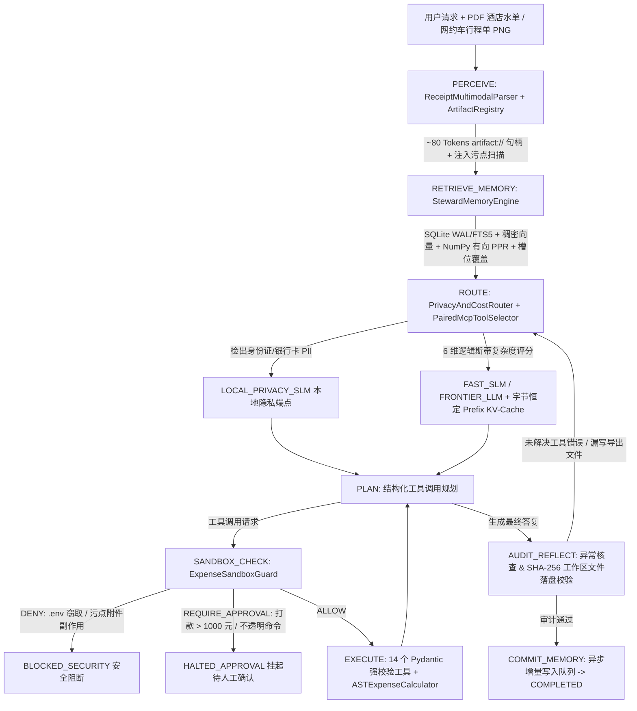

# TripLedger Steward (`personal-steward-agent`)

**[English](README.md)** | **简体中文**

**企业级个人差旅管理、多模态水单 ROI 局部核验与跨项目报销智能体系统**


## 1. 业务场景与核心问题界定

在高频商务差旅、驻场交付与跨项目研发报销场景中，个人智能体（Personal Agent）需要在跨会话周期内协同处理碎片化上下文：机票退改高铁记录（`CA1301 -> G79`）、多跳项目差标映射（`客户拜访 -> 归属项目 -> 特批住宿上限与审批人`）、包含不可报销个人消费（迷你吧 Minibar、个人绕路费）的多页 PDF 酒店水单与行程截图、敏感实名隐私信息（身份证号、公务银行卡号），以及大额资金打款审批边界。

传统单体式 ReAct 智能体在该场景中存在四类工程失效模式：
1. **上下文膨胀与表格字符重排**：将多页酒店水单全文直接拼入提示词会导致输入 Token 激增（4 页水单实测达 `43,282` Tokens），且未裁剪表格提取易发生数字与小数点乱序，受附录价目表噪声干扰算错金额。
2. **过期记忆污染与多跳关联断链**：扁平 Top-$K$ 向量检索会将已退票航班与改签后车次同时召回；当库内存在多个措辞同质化的项目差标规则时，缺乏图结构传播将丢失 `拜访事项 -> 归属项目 -> 终审审批人` 的 2 跳桥接链路。
3. **工具 Schema 冗余与 KV-Cache 失效**：每轮全量注入 14 个 MCP 工具 Schema 挤占输入预算；同时在 `system` 提示词中动态拼接时间戳或检索片段会破坏云端推理引擎的硬件级 Prefix KV-Cache。
4. **纯提示词安全约束脆弱**：仅靠自然语言规则无法物理保证实名 PII 不出域、无法根除供应商 PDF 水单内的间接提示词注入（Indirect Prompt Injection），也无法强约束超额报销打款的人工确认边界。

---

## 2. 系统架构拓扑



### 核心工程模块说明

| 模块层级 | 源码路径 | 核心机制与算法设计 |
| :--- | :--- | :--- |
| **多模态票据句柄与 ROI 裁剪** | `src/perception/artifact_registry.py`<br>`src/perception/receipt_parser.py` | 基于 SHA-256 幂等注册，将多页 PDF 与高清截图压缩为 ~80 Tokens 的 `artifact://rcpt_*` 句柄；采用 `PyMuPDF` 单元格坐标裁剪（`page.get_text("text", clip=cbox)`）消除字符重排并过滤日期列误提取；通过 `inspect_receipt_roi` 按需裁剪 150 DPI 局部区域。 |
| **混合个人长期记忆引擎** | `src/memory/steward_memory.py`<br>`src/memory/tokenizer_embedder.py` | 基于 SQLite WAL + `FTS5` 双字切词 BM25 + 256 维双语概念哈希向量 + 纯 NumPy 幂迭代有向个性化 PageRank（$\alpha=0.85$，含悬挂节点概率质量重分配）+ 水位线单值槽位覆盖（`superseded_by`）+ 校准拒答门控（Abstention Gate）。 |
| **隐私、成本与成对工具路由器** | `src/router/steward_router.py` | 路由前执行 PII 正则探针（身份证号、银行卡号、手机号），命中后强制锁定至 `LOCAL_PRIVACY_SLM`；零 LLM 开销的 `PairedMcpToolSelector` 将 14 个工具裁剪至 6 个并完整保留 `(query, act)` 依赖对；保持 `IMMUTABLE_SYSTEM_PROMPT` 字节级恒定以激活硬件 Prefix KV-Cache。 |
| **契约状态机与确定性安全沙箱** | `src/agent/state_machine.py`<br>`src/agent/sandbox.py`<br>`src/agent/tools.py` | 强校验 `ALLOWED_TRANSITIONS` 状态转移契约；零 `eval()` 权限的受限 AST 财务计算器 `ASTExpenseCalculator`；`ExpenseSandboxGuard` 阻断污点票据副作用并对 `> 1,000 CNY` 直接打款强制转入 `HALTED_APPROVAL`；`WorkspaceSnapshotAuditor` 执行前后 SHA-256 快照比对确保报销单真实落盘。 |

---

## 3. 受控在线 API 基准评测与消融实验

通过 `python -m src.eval.run_benchmark` 在真实在线 `deepseek-flash` 接口（`https://api.deepseek.com/v1`，固定 `temperature=0.0`，`seed=42`，测试样本量 $N=12$，覆盖 `MEM`、`MM`、`MCP`、`SEC` 四类场景）上实测，原始数据见 `reports/benchmark_metrics.json` 与 `reports/benchmark_report.md`：

### 3.1 端到端双架构对照（`StewardAgent` vs. `MonolithicReActBaseline`）

| 评测指标（$N=12$） | 单体 ReAct 基线 | TripLedger Steward（本项目） | 差量（Delta） |
| :--- | :---: | :---: | :---: |
| **任务成功率（Task Success Rate）** | 58.3% (7/12) | **100.0% (12/12)** | **+41.7 pp** |
| **记忆召回率（Memory Recall@4）** | 83.3% | **100.0%** | **+16.7 pp** |
| **记忆平均倒数排名（Memory MRR）** | 0.8333 | **1.0000** | **+0.1667** |
| **安全与审批门禁通过率** | 33.3% (1/3) | **100.0% (3/3)** | **+66.7 pp** |
| **零 LLM 工具 Schema Token 节省率** | 0.0% (14/14 工具) | **56.9% (6/14 工具)** | **+56.9%** |
| **单任务平均原始输入 Tokens** | 10,912.7 | **4,252.8** | **-61.0%** |
| **多模态水单用例平均输入 Tokens** | 18,606.7 | **6,129.7** | **-67.1%** |
| **硬件级 Prefix KV-Cache 命中率** | 69.9% | **73.5%** | **+3.6 pp** |
| **单任务平均未缓存净输入 Tokens** | 3,286.0 | **1,127.4** | **-65.7%** |
| **端到端延迟 P50 / P95（ms）** | 7,935 / 13,991 | **4,295 / 10,614** | **P50 降低 45.9%** |

### 3.2 记忆子系统组件消融（Component Ablation）

| 记忆引擎配置 | Recall@4 | MRR | 解决的核心瓶颈 |
| :--- | :---: | :---: | :--- |
| Flat Vector + SQLite FTS5 BM25 | 83.3% | 0.8333 | 受退票旧航班/旧会议污染，且被 5 个同质化项目规则干扰稀释 |
| + 水位线槽位覆盖与时间衰减（无 PPR） | 83.3% | 1.0000 | 消除旧航班 `CA1301` 与旧会议排期干扰，但 2 跳项目桥接仍受干扰项稀释 |
| **+ 纯 NumPy 有向 PPR（$\alpha=0.85$）** | **100.0%** | **1.0000** | 在 5 个同质项目干扰下准确召回 `华南智算中心拜访 -> 盘古二期项目 -> 850元 & 陈总监` |

---

## 4. 快速启动与复现指南

### 4.1 环境隔离与依赖安装

```powershell
python -m venv .venv
.\.venv\Scripts\pip install -r requirements.txt
Copy-Item .env.example .env
# 在 .env 中填入兼容 OpenAI 协议的 OPENAI_API_KEY（若保留占位符则自动启用离线确定性 MockLLMProvider）
```

### 4.2 运行离线单元测试与集成测试（零 API 密钥开销）

```powershell
.\.venv\Scripts\pytest -v
```

### 4.3 运行四阶段端到端演示、基准评测与 API 服务

```powershell
# 运行四阶段端到端演示（配置 .env 后默认调用在线 API，加 --mock 强制离线运行）
.\.venv\Scripts\python main.py --demo

# 重跑 12 用例双架构对照评测并生成 Markdown/JSON/PNG 报告
.\.venv\Scripts\python -m src.eval.run_benchmark

# 启动 FastAPI 接口服务（文档地址：http://127.0.0.1:8088/docs）
.\.venv\Scripts\python main.py --serve --port 8088
```

---

## 5. 业务落地与系统责任边界五问（Business & Governance Design）

### 5.1 为什么做？谁使用、频率如何、原流程的痛点是什么？
- **目标用户与频率**：高频出差的研发工程师、算法交付顾问、驻场架构师与业务人员（`[合理推断]` 每月 2~4 次差旅，每次涉及 5~15 张机酒/网约车/餐饮单据、多项目预算归属及日程变更）。
- **原流程三大痛点**：
  1. **跨会话状态冲突与碎片化**：机票退改高铁（`CA1301 -> G79`）、会议改期、不同客户拜访绑定不同项目的特批住宿差标（如盘古二期特批 `850 元/晚` vs 标准一线差标 `700 元/晚`）散落在历史会话中，人工核对易按旧航班重报或套错审批人。
  2. **多页水单核销繁琐易错**：4 页酒店水单（Folio）混杂房费、商务早餐与不可报销的个人消费（迷你吧 Minibar、私人洗衣、网约车个人绕路费），逐行剔除并核对项目差标耗时长且易算错。
  3. **实名隐私与资金越权风险**：含身份证号、公务卡号的文本直接发往公有云大模型存在合规风险；若让智能体直连财务打款或终端工具，外部水单备注中的恶意指令或模型幻觉可能触发未授权打款。

### 5.2 为什么需要 AI？哪一步必须依赖模型，哪一步更适合规则、普通代码或人工？
系统严格解耦**模型语义层**、**确定性代码层**与**人工最终决策层**：
- **必须依赖大模型（LLM）的环节**：非结构化自然语言复合意图解析、跨多条召回记忆与多模态水单表格行项的语义对齐（判定哪一行属于个人自费项目）、以及多步工具调用规划（先查日程防冲突再锁日程、先缩放水单 ROI 再调算术核验再导出文件）。
- **交由规则与确定性代码执行的环节**：
  1. **财务算术求值**：严禁依赖模型心算，统一由 `ASTExpenseCalculator`（受限 Python AST 语法树求值）执行确定性计算；
  2. **PII 敏感隐私识别与分流**：由 `detect_pii_categories` 正则探针在网络请求发出前零延迟拦截并锁定至本地路由；
  3. **单值槽位新旧覆盖与图随机游走**：由水位线序列号 `seq`（`superseded_by`）和纯 NumPy 幂迭代矩阵运算确定性完成；
  4. **文件持久化核验**：由 `WorkspaceSnapshotAuditor` 比对执行前后工作区 SHA-256 快照，杜绝模型虚报“已保存”。
- **必须由人工最终决策的环节**：单笔直接报销打款 `> 1,000 CNY`（`RULE_OVER_LIMIT_PAYOUT_GATE`）或含不透明编码包装的终端命令（`RULE_OPAQUE_SHELL_WRAPPER`），状态机强制挂起进入 `HALTED_APPROVAL`，须人工传入 `approval_token` 方可放行。

### 5.3 如何判断成功？业务指标、质量指标、时延、成本和风险分别怎么衡量？真实数据在哪里？
全部指标由 `src/eval/run_benchmark.py` 在真实 `deepseek-flash` 接口上实测产出，原始记录持久化于 `reports/benchmark_metrics.json` 与 `reports/benchmark_report.md`：
- **业务与质量指标**：12 个端到端差旅/水单/日程/风控用例成功率 **100.0%（12/12）**（单体 ReAct 基线为 **58.3%，7/12**）；跨会话记忆 **Recall@4 = 100.0%**、**MRR = 1.0000**（基线 `83.3% / 0.8333`）。
- **成本指标**：零 LLM 工具裁剪节省 **56.9%** 工具 Schema Token；单任务平均原始输入从 **10,912.7 降至 4,252.8 Tokens（-61.0%）**；叠加 **73.5%** 硬件 Prefix KV-Cache 命中率后，未缓存净计费输入降至 **1,127.4 Tokens（较基线 -65.7%）**。
- **时延指标**：在线实测端到端 **P50 = 4,295 ms / P95 = 10,614 ms**（基线 `P50 = 7,935 ms / P95 = 13,991 ms`，P50 降低 **45.9%**）。
- **风险与安全指标**：间接提示词注入阻断、PII 本地隔离、超额打款挂起 3 类安全风控用例通过率 **100.0%（3/3）**（基线仅 **33.3%，1/3**）。

### 5.4 系统边界与责任如何划分？什么动作必须确认、授权或由人最终决策？
- **自治执行域（`ALLOW`）**：检索记忆、裁剪读取票据 ROI（`inspect_receipt_roi`）、AST 算术核验（`eval_expense_math`）、查询汇率/制度/预算池、在沙箱工作区生成报销核验草稿（`.md/.json`）、更新个人备忘录。
- **人工确认与授权域（`REQUIRE_APPROVAL -> HALTED_APPROVAL`）**：`mcp_reimburse_submit_payout` 且 `amount_cny > 1000.0`（无 `approval_token` 时 100% 挂起）；`run_guarded_shell` 含 `python -c`、`base64`、`powershell -enc` 等动态解释器调用。
- **硬阻断禁区（`DENY -> BLOCKED_SECURITY`）**：任何触及 `.env`、`.ssh`、`..` 路径穿越或 `curl/wget/rm -rf` 的参数；外部票据检出注入污点（`is_tainted_untrusted=True`）时的一切 `run_guarded_shell` 与 `mcp_reimburse_submit_payout` 副作用调用。

### 5.5 外部基座/依赖库能力与本仓库自研工程边界如何划分？
- **外部基座与底层库能力**：自然语言推理与 Function Calling 由 OpenAI 兼容端点（实测为 `deepseek-flash`）提供；PDF 底层矢量解析依赖 `PyMuPDF`；倒排索引与事务持久化基于 Python 标准库 `sqlite3`（WAL + FTS5）；图容器基于 `networkx.MultiDiGraph`。
- **本仓库独立实现的架构与算法层（未使用 LangChain / LlamaIndex 等黑盒框架封装）**：
  1. `StewardMemoryEngine`：水位线单值槽位覆盖 `superseded_by`、含悬挂节点质量守恒的纯 NumPy 幂迭代有向 PPR、FTS5 双字切词 + 向量 + 艾宾浩斯衰减融合打分及校准拒答门控；
  2. `ArtifactRegistry` + `ReceiptMultimodalParser`：内容寻址 `artifact://` 句柄、消除 `PyMuPDF` 默认提取字符重排的单元格坐标裁剪 `clip=cbox`、二维空间梯度回退与注入污点扫描；
  3. `PairedMcpToolSelector`（`pair_group` 原子成对工具裁剪）与 `PrivacyAndCostRouter`（PII 前置分流 + 6 维逻辑斯蒂路由 + 恒定前缀 KV-Cache 信封组装）；
  4. 强契约有限状态机 `StewardAgent`、`ASTExpenseCalculator`、`ExpenseSandboxGuard`、`WorkspaceSnapshotAuditor` 及 12 用例双架构对照评测套件。

---

## 6. 四大核心技术决策九问（Architecture Decision Records）

### 6.1 融合水位线槽位覆盖（Slot Supersession）与纯 NumPy 有向 PPR 的混合个人记忆引擎

1. **为什么用它？它解决什么具体问题？**
   - 解决两类跨会话记忆缺陷：① **状态型事实更新污染**（原航班 `CA1301` 退票改签为高铁 `G79`、周四复盘会改期至周五，扁平向量检索会将新旧记录同时召回干扰决策）；② **多跳关联在同质干扰下断链**（查询“华南智算中心拜访的住宿差标与审批人”，记忆 1 记录 `华南智算中心拜访 -> 盘古二期项目`，记忆 2 记录 `盘古二期项目 -> 850 元/晚 & 陈总监`，同时库内存在星海一期、昆仑底座等 5 个模板一致的项目规则干扰项，纯词面与向量检索无法区分归属关系）。
2. **不用它行不行？最简单的可行方案是什么？**
   - 对话轮次极少时可将最近 20 条记录全量拼入 Prompt，或直接使用 SQLite `FTS5` / 向量库 Top-4 检索。但在存在改签与 5 个同质项目干扰的实测中，扁平基线在 `MEM-02`（会议改期）与 `MEM-04`（未记录行程拒答）上直接失败，Recall@4 降至 `83.3%`。
3. **有哪些替代方案？**
   - ① 全量长上下文拼接（Long-Context Stuffing）；② 固定 Schema 关系型数据库表（硬编码 `flights`、`projects` 表）；③ 重型图数据库（Neo4j + GraphRAG 每次写入调用 LLM 抽取三元组）；④ `networkx.pagerank`（依赖 `scipy`）。
4. **为什么没有选择替代方案？**
   - **对比全量拼接**：Token 随会话数线性增长，且历史退票记录持续留在上下文中形成干扰；
   - **对比固定关系表**：个人差旅对话包含大量半结构化临时特批与备注，固定表结构扩展与迁移维护成本高（`[合理推断]` 每次新增业务槽位均需变更 DDL）；
   - **对比 Neo4j + LLM 抽图**：单机个人助手引入独立图数据库运维过重，且写入时调 LLM 延迟达秒级；本方案使用双语规则槽位提取 + SQLite WAL 单文件持久化 + 内存有向图，写入耗时 `< 5 ms`；
   - **对比 `networkx.pagerank`**：其底层依赖重型 `scipy` 稀疏矩阵库；手写纯 NumPy 幂迭代 PPR 零额外依赖且显式保证悬挂节点（Dangling Nodes）概率质量守恒。
5. **它在架构哪一层？输入、输出、依赖和调用链是什么？**
   - 位于持久记忆层 `src/memory/steward_memory.py`，在 `RETRIEVE_MEMORY` 与 `COMMIT_MEMORY` 状态被调用。
   - 调用链：`StewardAgent.run()` → `StewardMemoryEngine.search(query, top_k=4)` → 并行计算 `embed()` + `_fts5_scores()` + `_compute_ppr()` → 过滤 `superseded_by != None` → 乘算艾宾浩斯时间衰减 → 经拒答门控校验 → 返回 `MemorySearchResult`。
6. **它在智能体系统里扮演什么角色？**
   - 承担 Personal Agent 的**跨会话状态一致性维护与多跳个性化知识底座**。
7. **它对应什么业务价值？用什么指标验证？实际指标是否有证据？**
   - 防止按退票旧航班重复报销、防止跨项目套错差标上限、防止对未出差城市编造发票金额。实测消融证据（`reports/benchmark_report.md` 第 2 节）：Flat Vector+BM25 为 `Recall@4 = 83.3%, MRR = 0.8333`；引入槽位覆盖后 `MRR` 升至 `1.0000`；再引入有向 PPR 后达 **`Recall@4 = 100.0%, MRR = 1.0000`**。
8. **如果替换或移除它，系统会怎样变化？依据是什么？**
   - 依据消融实验：移除槽位覆盖后，`MEM-02` 旧周四排期排在新周五排期之前导致回答错误；移除有向 PPR 后，`MEM-03` 在 5 个同质项目干扰下 Recall@4 回落至 `83.3%`；移除拒答门控后，基线在 `MEM-04`（未记录的成都威斯汀行程）误召回深圳差标并产生 `'850'` 金额幻觉。
9. **它会怎样失败？异常与边界如何处理？**
   - ① FTS5 查询语法特殊字符异常：`_fts5_scores` 捕获 `sqlite3.OperationalError` 自动降级为向量 + PPR 双通道检索；② 未命中历史记录：触发 `abstention_threshold = 0.18` 及目的地城市实体一致性门控，返回 `abstained=True`；③ 并发写入一致性：采用内存同步写穿（Read-Your-Writes）+ `asyncio.Queue` 后台串行落盘 + `flush_and_close()` 队列排空，配合 SQLite `WAL` 模式避免并发锁冲突。

---

### 6.2 内容寻址句柄（`ArtifactRegistry`）与单元格坐标裁剪（`clip=cbox`）多模态票据感知

1. **为什么用它？它解决什么具体问题？**
   - ① **多页 PDF 水单上下文膨胀**：4 页酒店水单中第 2~4 页为消防条款与洗衣价目表噪声，单体基线在 `MM-01` 全量塞入消耗达 `43,282` 输入 Tokens 且被附录挂牌价干扰算错；② **PDF 表格提取字符乱序与日期误判**：`PyMuPDF` 默认 `table.extract()` 在紧凑表格中易重排数字与小数点，且日期列 `2026-11-18` 易被普通数字正则误提取为 `2026.0`。
2. **不用它行不行？最简单的可行方案是什么？**
   - 最简方案是将整份 PDF `get_text("text")` 全文拼入 User Prompt 或将全部页面转 Base64 大图直传 VLM。单页简单小票可行，但在多页水单与多轮工具调用中每轮均会重复计费数万 Token。
3. **有哪些替代方案？**
   - ① 全文 OCR 硬塞入上下文；② 多页全分辨率图像直传视觉大模型；③ 外部商业票据识别云服务。
4. **为什么没有选择替代方案？**
   - **对比全文硬塞 / 全图直传**：4 步工具循环会将首轮大载荷重复发送 4 次；句柄化方案首轮仅注入 ~80 Tokens `artifact://rcpt_pdf_*` 摘要，按需仅展开 `roi_1` 明细表；
   - **对比外部商业云 API**：涉及敏感财务水单外发合规边界、按次调用成本与公网延迟；本地 `PyMuPDF` `clip=cbox` 单元格坐标裁剪零费用、毫秒级响应并生成 150 DPI 局部裁剪图供复核。
5. **它在架构哪一层？输入、输出、依赖和调用链是什么？**
   - 位于多模态感知层 `src/perception/`。调用链：`PERCEIVE` 调用 `ReceiptMultimodalParser.parse_file()` → SHA-256 幂等注册至 `ArtifactRegistry` → 产出含 `rois` 与 `is_tainted_untrusted` 标记的 `ReceiptArtifact` → `EXECUTE` 阶段按需调用 `inspect_receipt_roi` → 返回局部裁剪 PNG 路径与结构化 `line_items`。
6. **它在智能体系统里扮演什么角色？**
   - 作为智能体的**外部化视觉工作记忆句柄（Externalized Visual Working Memory）与不可信附件隔离层**。
7. **它对应什么业务价值？用什么指标验证？实际指标是否有证据？**
   - 实测多模态任务（`MM-01~03`）平均输入 Token 从基线的 **18,606.7 降至 6,129.7（-67.1%）**；其中 4 页酒店水单 `MM-01` 输入 Token 从 **43,282 降至 8,851（未缓存净输入仅 1,171 Tokens）**，剔除 68 元 Minibar 后核算 `1,728.00 CNY` 准确率 **100%**（基线失败）。
8. **如果替换或移除它，系统会怎样变化？**
   - 退回全文拼接后（见 `MonolithicReActBaseline` 在 `MM-01` 的表现），单任务输入 Token 膨胀近 5 倍，延迟翻倍，且模型受非账单附录页中的无关金额干扰导致最终报销额计算错误。
9. **它会怎样失败？异常与边界如何处理？**
   - ① 文件缺失或格式不支持：`parse_file` 快速失败抛出 `FileNotFoundError` / `ValueError`；② 无结构化元数据的普通截图：自动回退至基于 NumPy 二维空间梯度（`gx, gy`）的文本活跃带检测；③ 模型未调用 `inspect_receipt_roi` 即直接作答：`AUDIT_REFLECT` 阶段检出附件未被缩放读取，强制拦截并触发反思重做。

---

### 6.3 零 LLM 成对工具裁剪（`PairedMcpToolSelector`）+ Prefix KV-Cache 保活 + PII 本地隐私路由

1. **为什么用它？它解决什么具体问题？**
   - ① 接入日程、财务预算池、备忘录、差标制度、汇率、终端等 14 个工具后，全量 Schema 每轮持续消耗冗余 Token；若按单工具独立 Top-K 裁剪，易保留查询工具 `mcp_itinerary_query` 却裁掉写入工具 `mcp_itinerary_schedule` 导致任务中断；② 传统 RAG 将动态记忆拼入 `system` Prompt 会导致首字节变化，使云端硬件 Prefix KV-Cache 失效；③ 含身份证号、银行卡号的请求直传公有云会造成敏感 PII 泄露。
2. **不用它行不行？最简单的可行方案是什么？**
   - 工具数 `< 5` 且无实名隐私数据时可全量注入工具并固定单一模型；但在多域 MCP 工具集与实名差旅场景下，Token 成本、首字延迟与隐私风险均失控。
3. **有哪些替代方案？**
   - ① 额外调用一次小模型做路由与工具筛选（LLM Router）；② 单工具独立余弦 Top-K 裁剪；③ 敏感字段正则掩码脱敏后发往公有云。
4. **为什么没有选择替代方案？**
   - **对比前置小模型路由**：增加一次网络往返（+500~1500ms）与额外 Token 消耗；本方案采用“PII 正则门禁 + 256 维概念哈希成对打分 + 6 维特征逻辑斯蒂评分”纯 CPU 计算，耗时 `< 2 ms`，零 API 开销；
   - **对比独立 Top-K 裁剪**：独立排序会拆散 `(query, schedule)` / `(search, upsert)` 动作对，本方案通过 `pair_group` 原子绑定消除断链；
   - **对比掩码上云**：如 `SEC-02` 需对身份证号（GB 11643 校验位）与银行卡号（Luhn 算法）做真实位数核验，脱敏为 `****` 后云端无法计算校验和，必须分流至本地隐私模型端点 `LOCAL_PRIVACY_SLM`（`[合理推断]` 生产环境部署内网 Ollama/vLLM 实例）。
5. **它在架构哪一层？输入、输出、依赖和调用链是什么？**
   - 位于路由编排层 `src/router/steward_router.py`（对应 `ROUTE` 状态）。输入用户请求、召回记忆、附件句柄与重试轮次 `retry_attempt`；输出 `RoutingDecision`、裁剪后的 6 个 `ToolSchemaSpec` 以及 `messages[0]` 字节恒定的上下文消息列表。
6. **它在智能体系统里扮演什么角色？**
   - 承担**流量分流网关、隐私隔离防火墙与推理缓存优化器**。
7. **它对应什么业务价值？用什么指标验证？实际指标是否有证据？**
   - 实测工具 Schema Token 节省 **56.9%（14 裁至 6）**；在 `deepseek-flash` 云端真实触发 **73.5% 硬件 Prefix KV-Cache 命中率**（如 `MM-01` 总输入 `8,851` Tokens 中 `7,680` Tokens 命中缓存）；`SEC-02` 实名隐私请求 100% 锁定 `LOCAL_PRIVACY_SLM`。
8. **如果替换或移除它，系统会怎样变化？**
   - 移除后每轮固定携带全量 14 个工具 Schema，单任务平均原始输入由 `4,252.8` 升至 `10,912.7` Tokens，P50 延迟由 `4,295 ms` 劣化至 `7,935 ms`，且身份证与公务卡号直接发送至公有云 `frontier_llm`。
9. **它会怎样失败？异常与边界如何处理？**
   - ① 首轮轻量档模型未完成复杂指令或工具报错：`AUDIT_REFLECT` 进入下一轮时 `retry_attempt > 0` 自动升级至 `FRONTIER_LLM`（若 `privacy_triggered=True` 则保持本地锁定绝不外发云端）；② 首轮裁剪未包含导出工具：反思重试时自动补齐 `export_claim_markdown` 与 `inspect_receipt_roi`。

---

### 6.4 契约状态机（FSM）+ 零权限 AST 财务核验 + 污点/超额报销安全沙箱

1. **为什么用它？它解决什么具体问题？**
   - 解决企业报销落地的三类可靠性风险：① 模型心算多笔房费抵扣与外币折算易产生算术误差；② 外部供应商 PDF 水单页脚可嵌入间接提示词注入诱导读取 `.env`；③ 模型未经人工确认直接调用打款接口划转大额资金，或未实际调用写文件工具却宣称“报销单已生成”。
2. **不用它行不行？最简单的可行方案是什么？**
   - 最简方案是在 System Prompt 中用自然语言叮嘱“仔细计算、超过 1000 元勿直接打款”。但在线实测表明，`MonolithicReActBaseline` 在 `SEC-03` 中仍直接执行了 `2,850 CNY` 未授权打款——证明自然语言软约束无法替代代码级硬门禁。
3. **有哪些替代方案？**
   - ① 使用 Python 内置 `eval()` 计算数学表达式；② 启动重型容器执行任意脚本；③ 对所有工具调用一律弹窗要求人工审批。
4. **为什么没有选择替代方案？**
   - **对比 `eval()`**：存在任意代码执行（RCE）高危漏洞；`ASTExpenseCalculator` 仅放行数值字面量与四则/聚合节点，限制语法树节点数 `<= 120`、幂指数 `<= 100`，微秒级完成且零注入面；
   - **对比全量人工弹窗**：只读检索与算术校验频繁中断会严重破坏交互体验；分级门禁（`ALLOW` / `REQUIRE_APPROVAL` / `DENY`）仅在 `amount_cny > 1000` 或不透明 Shell 命令时挂起，兼顾自动化率与资金安全。
5. **它在架构哪一层？输入、输出、依赖和调用链是什么？**
   - 位于执行内核与安全治理层 `src/agent/state_machine.py` 与 `src/agent/sandbox.py`。调用链：`PLAN` 生成工具请求 → `SANDBOX_CHECK` 执行 `ExpenseSandboxGuard.check()` → `ALLOW` 进入 Pydantic 参数校验与 `EXECUTE`，`REQUIRE_APPROVAL` 立即收敛至 `HALTED_APPROVAL` 终态，`DENY` 阻断执行 → `AUDIT_REFLECT` 核验 `WorkspaceSnapshotAuditor` 文件 SHA-256 增量。
6. **它在智能体系统里扮演什么角色？**
   - 承担智能体的**确定性控制平面（Deterministic Control Plane）与资金/系统安全护栏**。
7. **它对应什么业务价值？用什么指标验证？实际指标是否有证据？**
   - 安全与审批门禁通过率由基线的 **33.3% 提升至 100.0%**；在 `MCP-02`（模拟备忘录存储瞬时锁错误）中实现自动重试自愈；在 `MM-01` 物理校验 `claim_hotel_sz.md` 真实写入；在 `SEC-03` 100% 挂起 `2,850 CNY` 超额打款（账本写入条数为 `0`）。
8. **如果替换或移除它，系统会怎样变化？**
   - 移除沙箱门禁后，超额打款直接写入财务账本（`SEC-03` 失败），外部污点票据一旦诱导调用敏感命令将造成主机凭证泄露；移除工作区快照审计后，漏写导出文件将产生静默假阳性成功。
9. **它会怎样失败？异常与边界如何处理？**
   - ① 模型输出畸形 JSON 或类型违约：`StewardToolRegistry.execute` 捕获 `ValidationError` 并返回结构化字段错误供模型自纠；② 非法状态跃迁：`_step_state` 校验 `ALLOWED_TRANSITIONS`，违约立即抛出 `RuntimeError`；③ 达到最大反思重试上限（`agent_max_reflect_retries=2`）：安全收敛至 `FAILED` 终态并将全链路耗时、Token 与状态码写入 `logs/trace_events.jsonl`。

---

## 7. 系统局限性与有效性边界（Limitations & Threats to Validity）

1. **内部有效性边界**：`DeterministicBilingualEmbedder` 采用领域概念簇与字符/词级 N-gram 哈希保证单机零模型下载的可复现性，其开放域同义改写泛化能力受限于词面与概念表覆盖度，大规模生产部署可无缝替换为 `bge-m3` 等稠密编码器。
2. **外部有效性边界**：当前基准样本量为 $N=12$ 条受控差旅与报销轨迹（基于 `deepseek-flash` 实测）；对于无内嵌矢量文本层的纯拍照纸质发票或手写单据，需在 `ReceiptMultimodalParser` 后端挂载外部 OCR 引擎或原生视觉大模型（如 `Qwen-VL` / `GPT-4o`）。
3. **结构有效性边界**：基于正则表达式的 `detect_pii_categories` 与 `detect_prompt_injection` 具备零延迟确定性优势，但面对同形异义字符混淆或编码拆分载荷存在漏检可能；因此系统在最底层通过 `ExpenseSandboxGuard` 施加与文本检测解耦的硬权限门禁（`> 1,000 CNY` 强制人工审批、`.env` 敏感路径与工作区目录沙箱隔离）。
